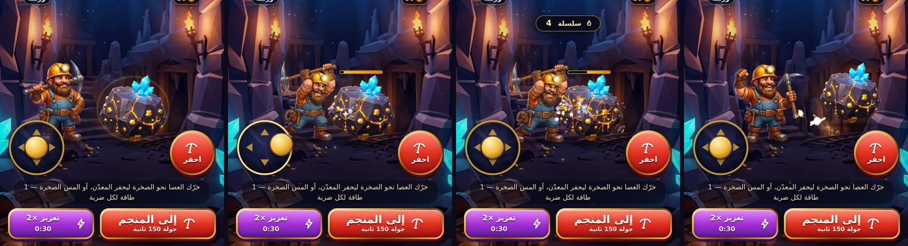
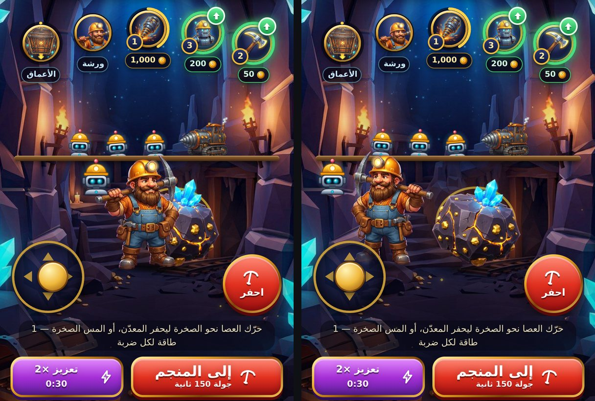
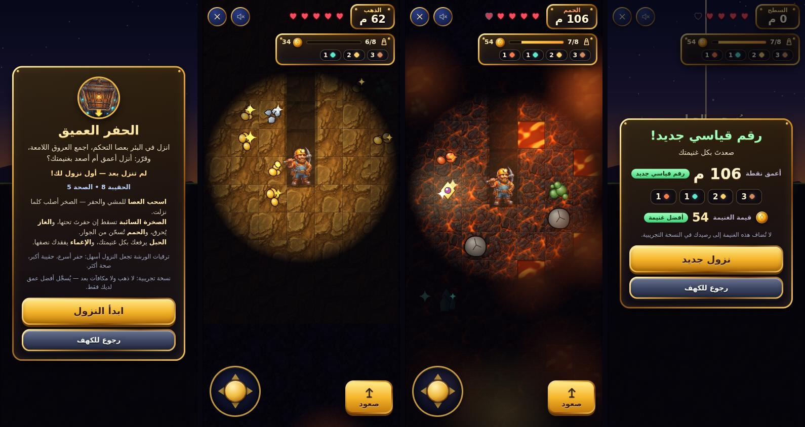

# مركز الكهف — تبويب التعدين والورشة بالفن المرسوم

طلب المستخدم أن تصبح شاشة التعدين «مثل هذا»، مرفقاً لقطة من لعبة تعدين أخرى (مشهد كهف، ميداليات ذهبية بحلقات تقدّم حول مدخل المنجم وحول روبوت، عدّاد ذهب مزخرف، سهم إرشاد، وزر أحمر كبير «إلى المنجم»). اعتُمدت اللقطة **إلهاماً للبنية والتفاعل فقط**: كل الفن هنا أصلي ومولَّد لهذا المشروع، بلا نصوص ولا شعارات ولا أيقونات منقولة.

| مركز الكهف | نافذة الترقية | الورشة |
| --- | --- | --- |
|  |  |  |

*موقع الحفر (أربع لقطات متتابعة): ١ البداية بحلقة إرشاد حول الصخرة · ٢ سحب العصا فيمشي المعدّن ويحفر · ٣ شقوق وشريط صحة وسلسلة نقرات · ٤ تفتّت الصخرة واحتفال المعدّن وصخرة جديدة.*

> **عميل فقط — لا اقتصاد ولا خادم.** الذهب والطاقة والعمليات كما هي (نقرة = طاقة واحدة، تعزيز ×2 لـ30 ثانية، تهدئة 5 دقائق، شراء الترقية عملية `buy` عادية يتحقق منها الخادم، والمعدات عملية `buy_equip`). الاستثناء الوحيد في `server.js` سطر واحد يخزّن صور `/assets/cave` أسبوعاً (انظر «التخزين المؤقت»).

## التفاعل

| العنصر | السلوك |
| --- | --- |
| **الصخرة** | اللمس عليها يعدّن (نقرة واحدة = طاقة واحدة) ويصيبها (انظر «موقع الحفر»). تميل ثلاثياً نحو موضع اللمس وتنضغط وتنبض؛ وميض وموجة وشظايا ذهب وصخر عند نقطة الضربة؛ عروقها تتوهّج أكثر مع النقر المتواصل وتتلوّن بنفسجياً بالتعزيز وبالأحمر في «حمّى التعدين». **المعدّن لا يعدّن باللمس** (يُحرَّك بالعصا؛ تمرّ اللمسة إلى ما خلفه) ولمس الزينة بين الميداليات لا يعدّن أيضاً. |
| **الميداليات الخمس** | ثلاث ترقيات (فأس فولاذي، عامل آلي، منصة تعدين عملاقة) على قوس ضحل فوق الساحة + ميدالية الورشة + ميدالية «الأعماق» (تفتح الحفر العميق، حلقتها = أفضل عمق ÷ عمق الصندوق، وعليها شارة «جديد» حتى تُفتح أول مرة). **حلقة التقدّم** = رصيدك ÷ سعر الترقية؛ حين يكفي الرصيد تخضرّ الحلقة ويظهر سهم أخضر؛ شارة المستوى (عدد المشتريات) وشريحة السعر تحتها؛ نقطة حمراء على تبويب الترقيات. |
| **نافذة الترقية** | تُفتح بلمس ميدالية: اسم، وصف، «المستوى / الحالي / التالي» (محسوبة بـ`base + owned × gain` كما يطبّقها `UPGRADES.apply`)، السعر والرصيد أو «ينقصك N»، وزر «ترقية» بنفس `buyUpgrade`. تبقى مفتوحة لسلسلة مشتريات؛ تُغلق بـEscape أو لمس الخلفية أو زر الإغلاق أو مغادرة التبويب؛ التركيز ينتقل إليها ويُحبس فيها ويعود إلى الميدالية. |
| **إرشاد أول مرة** | سهم أخضر ونص «اضغط على الأيقونة لفتح نافذة الترقية» تحت أول ميدالية جاهزة، حتى تُفتح أي نافذة (يُحفظ في `mining-fx-hint`). |
| **«إلى المنجم»** | الزر الأحمر الكبير: ينتقل إلى جولة المنصّات (150 ثانية) ويبدأها؛ وإن كانت هناك جولة موقوفة لا يستبدلها بل يترك للاعب «متابعة الجولة». |
| **ميدالية الورشة** | تفتح الورشة بملء الشاشة؛ تخضرّ مع سهم حين تكفي الأرصدة (ذهب + خامات) لترقية معدة. |
| **العدّاد والصوت** | عدّاد الذهب بإطار ذهبي مشطوف وعملة مرسومة، وزر كتم الصوت بجانبه (يظهر مع المشهد فقط). |

عند ارتفاع الشاشة ≤ 700px تُخفى ترويسة الملف الشخصي لتفسح المجال للمشهد؛ وفي العرض الأفقي القصير تصير الميداليات عموداً بجانب الصخرة والأزرار مكدّسة على الطرف الآخر.

## موقع الحفر — المعدّن يمشي بعصا التحكم ويحفر

طلب المستخدم أن يكون التعدين «تفاعلياً أكثر، مثلاً الرجل يقوم بالحفر عبر تحريك عصا التحكم». فتحوّلت ساحة التعدين من صورة تُنقر إلى **موقع حفر صغير**: المعدّن شخصية تمشي على أرض الكهف، والصخرة لها «صحة» تتشقق ثم تتفتت وتظهر صخرة جديدة في مكان آخر فيمشي إليها.

> **الاقتصاد كما هو.** كل ضربة تصيب الصخرة هي **نقرة عادية** بحذافيرها (`handleMine`): طاقة واحدة × قوة النقر، وذهب النقرة الحالي (×2 بالتعزيز)، ونقرة واحدة في عملية `mine` المجمَّعة التي يحاسبها الخادم على الطاقة ومعدّل النقر. الضربات التلقائية **≤ 4 في الثانية** (دورة الضربة 0.26 ثانية) أي أبطأ مما تسمح به النقرات اليدوية أصلاً، ويبقى قصّ الخادم فوق 20/ث. صحة الصخرة (12 ضربة) **بصرية فقط**: تفتّتها لا يمنح مكافأة ولا يلمس الخادم. لا تغيير في `server.js` ولا `platform-*.js` ولا `db.js`.

| الإدخال | السلوك |
| --- | --- |
| **العصا** (أسفل يسار الساحة) | اسحبها بإصبع (أو الفأرة): يمشي المعدّن نحو اتجاه الإصبع بسرعة تتناسب مع الإزاحة (منطقة ميتة 16% ثم تدرّج ناعم)، يلتفت (الصورة تنعكس) ويتبدّل بين إطاري المشي؛ الحركة نحو الأعماق أبطأ وتصغّر الشخصية قليلاً. عند الرفع تعود العصا إلى المنتصف. الإصبع محبوس بـ`setPointerCapture` فلا يضيع السحب عند الخروج من العصا، وتحمل العصا `touch-action: none` فلا تتحرك الصفحة (وسحب إغلاق تيليجرام معطّل أصلاً بـ`disableVerticalSwipes`). |
| **الحفر بالعصا** | حين تدفع العصا **نحو الصخرة** وهو في متناولها يرفع المعول ويضرب تلقائياً؛ الابتعاد عنها أو الالتفاف حولها يوقف الضرب. |
| **زر «احفر»** (أسفل اليمين) | اضغط مطوّلاً: يمشي المعدّن إلى الصخرة بنفسه ويحفر ما دام الزر مضغوطاً ويتابع إلى الصخرة التالية بعد التفتّت. العصا والزر معاً بإبهامين يعملان. |
| **لوحة المفاتيح** | الأسهم أو WASD للمشي، المسافة أو E للحفر. لا تُعترض المسافة إن كان التركيز على زر، ولا الأسهم داخل حقل كتابة، والصفحة لا تتمرّر بالأسهم. ضغطة Enter/Space على زر «احفر» نفسه ضربة واحدة. |
| **لمس الصخرة** | يعدّن فوراً كما كان ويصيب الصخرة؛ ثم يمشي المعدّن إليها ويلوّح بالمعول **تمثيلاً فقط، بلا خصم ثانٍ**. |
| **بلا طاقة** | الضربة المرفوضة لا تُدفع ولا تُرسل ولا تؤذي الصخرة؛ تظهر ملاحظة «لا طاقة» الحمراء، وتُستأنف المحاولة التلقائية كل 0.7 ثانية فقط؛ وحين تعود الطاقة يكمل المعدّن الحفر دون لمسة جديدة. |
| **النوافذ والتبويبات** | نافذة ترقية أو ورشة أو تبويب آخر أو صفحة في الخلفية أو فقدان التركيز: تُفلت العصا وتُنسى المفاتيح وتتوقف الحلقة تماماً (لا إطارات تُصرف)؛ العودة تعيد القياس والوضع. |

- **الصخرة.** 12 ضربة: من 12 إلى 9 سليمة، من 8 إلى 5 شقوق، من 4 إلى 1 توشك على التفتّت (ثلاثة إطارات من ورقة السبرايت) مع شريط صحة فوقها. عند التفتّت: انفجار جسيمات ذهب وصخر وصوت «تفتّت» مولَّد وشبح للصخرة القديمة يتلاشى، والمعدّن يرفع قبضته ابتهاجاً، وتظهر صخرة كاملة **خارج متناول المعدّن وبعيداً عن العصا والزر** (يتحقق الاختبار من ذلك على 30 ظهوراً في كل مقاس).
- **الحركة والرسم.** الموضع بنسب من الساحة (قدما المعدّن بين 58% و88% من الارتفاع، والصخرة بين 62% و80%)؛ الحجم يكبر قليلاً نحو الشاشة (0.84–1.10) وترتيب الرسم بحسب العمق، ويُرفع المعدّن أمام الصخرة حين يصل إليها كي لا يختفي نصفه خلفها. أنصاف أقطار التصادم والمتناول تُقاس من أبعاد الرسم الفعلية فتصحّ على كل مقاس. الأحجام بوحدات الحاوية (`cqw/cqh` مع احتياط `vw`). المعدّن لا يعترض اللمس (`pointer-events: none`) والصخرة هي الهدف الوحيد للمس داخل العالم.
- **الحلقة والأداء.** حلقة `requestAnimationFrame` واحدة لا تعمل إلا عند الحاجة (عصا أو زر أو اقتراب أو ضربة أو احتفال أو مشي) وتنام حين يهدأ كل شيء. الخطوة الزمنية مقصوصة عند 0.1 ثانية: الإطارات البطيئة **تُبطئ** المحاكاة ولا تُسرّعها أبداً، فلا يتجاوز إيقاع الضرب 4/ث على أي جهاز. التحديث بـ`transform` و`z-index` و`data-*` فقط بلا قراءة تخطيط داخل الحلقة. في ملف أداء لأربع ثوانٍ من الحفر المتواصل كان الخيط الرئيسي خاملاً 96% وسكربت الصفحة أقل من 15ms؛ ومعدل الإطارات في بيئة الاختبار (معالجان بلا GPU) متذبذب بين نحو 7 و58 إطاراً/ث بحسب الحمل. **لم يُجرَّب على Android ضعيف حقيقي.**
- **الاحتياط.** إن غاب `dig-site.js` أو تعطّل: يبقى المعدّن والصخرة في موضعيهما الافتراضيين من CSS، والعصا وزر الحفر مخفيان، ولمس الصخرة يعدّن بالمسار القديم. كل واجهة ومعالج حدث فيه محصّن بـ`try/catch`. وإن تعذّر تحميل ورقة السبرايت يظهر رسم بديل بسيط (`.no-hero-art` و`.no-ore-art`).
- **الكود.** `public/dig-site.js` (وحدة UMD اسمها `DigSite`: النماذج الصافية `stickVector` و`stepMiner` و`separate` و`createSwing` و`hitRock` و`pickRockSpot` و`poseFor` … تُختبر في Node بلا DOM، ثم المتحكم)، قسم «ساحة التعدين» في `clicker.css`، والعلامات `#ck-world` و`#ck-miner` و`#ck-pad` و`#ck-dig` و`#ck-rockhp` في `index.html`. ربطها بالصفحة ثلاثة أسطر: `DigSite.init` بـ`handleMine` وحده كأثر، و`DigSite.onTap` بعد كل نقرة مقبولة على الصخرة، و`DigSite.onTab` عند تبديل التبويب.

## طاقم المنجم ورفيق الروبوت وتحسين المشي

اختيار المستخدم (الخيار 4 من قائمة «المغامرة الممتعة»). **عرض فقط: لا اقتصاد ولا خادم ولا عمليات** — الشاشة تعكس ما اشتراه اللاعب وما رقّاه في الورشة ولا تغيّر شيئاً. يثبت ذلك اختبار تكامل الصفحة (الذهب لا يتحرك عند رسم الطاقم) واختبار المتصفح (لمس الطاقم لا يعدّن).

| العنصر | السلوك |
| --- | --- |
| **طاقم المنجم** | على سقالة خشبية فوق ساحة الحفر مباشرة فوق رأس المعدّن: **عامل آلي صغير** لكل «عامل آلي» مُشترى (حتى 5) يتمايل كأنه يعمل، و**منصة حفر** مرسومة لكل «منصة تعدين عملاقة» (حتى 2). ما زاد يظهر شارة «+N» فلا تزدحم الساحة. صار الدخل السلبي مرئياً بدل أن يكون رقماً فقط. |
| **رفيق المعدّن** | من يرقّي «الروبوت» في الورشة (المستوى ≥ 1) ترافقه طائرة روبوت (رسم الورشة نفسه) تطفو عند كتفه وتتبعه أينما مشى؛ هي ابن عنصر المعدّن نفسه فلا حساب موضع في الجافاسكربت. |
| **المشي** | إطارا المشي في ورقة السبرايت متقاربان فكان يبدو انزلاقاً. أُضيف بـCSS خالص: **خطوة بوزن** (ارتفاع وهبوط وميل يتبدّل قدماً بعد قدم وانضغاط عند الارتطام)، و**ظل يتنفس** مع كل خطوة، و**غبار خلف القدمين** يتبع اتجاه نظره؛ وعند السكون يعود التنفس الهادئ. حلّ محل القفزة البسيطة القديمة. |
| **تقليل الحركة** | الطاقم والرفيق والخطوة والغبار كلها تقف (يبقى المعدّن يمشي دون اهتزاز). |

- **الاحتواء.** الطاقم لا يعترض اللمس (`pointer-events: none`) ويقع خلف المعدّن والصخرة؛ يفحص اختبار المتصفح على **6 مقاسات** أنه داخل الساحة ولا يتداخل مع الصخرة ولا العصا ولا زر الحفر. مؤشر «ابدأ من هنا» لأول مرة يتداخل مع صف الطاقم مؤقتاً (مقبول: يزول بأول لمسة).
- **الفن.** `crew/rig.webp` وحده جديد (303×256 · 26KB، يُحمَّل مسبقاً)؛ إن تعذّر تحميله تُرسم المنصة كتلة فولاذية بدل ثقب فارغ (الصنف `no-crew-art`). العمال الآليون والطائرة هم رمز `a-robot` الموجود أصلاً في سبرايت الصفحة.
- **الكود.** النموذج الصافي `ClickerFX.crewView(owned)` → `{ bots, rigs, moreBots, moreRigs, total }` (سقف 5 و2، أعداد صحيحة فقط، ومدخلات تالفة = صفر)، والرسم `renderCrew` (لا يعيد بناء الصف إلا إن تغيّر التوقيع)، والمستوى `robot` يصل في حمولة المزامنة قراءةً فقط (`index.html`)، وقواعد `.ck-crew*` و`.ck-companion` و`.ck-dust` وحركات `ck-stride` و`ck-footfall` و`ck-puff` في `clicker.css`.
- **حدود.** العمال لا «يجلبون» شيئاً فعلاً (الدخل نفسه كما كان)، وإطارا المشي في الفن ما زالا متقاربين (الحل بالحركة لا بإعادة الرسم).

## الحفر العميق — بئر عمودي بطبقات وفخاخ وحقيبة

سأل المستخدم «هل في تحسينات إضافية تجعل اللعبة مغامرة ممتعة؟»، فقدّمتُ أربعة اتجاهات بعد فحص الكود (المناجم الستة تستعمل **خريطة واحدة** بلا زعيم، والصوت نغمات قصيرة فقط، ومهمتان يوميتان معطّلتان) فاختار هذا الاتجاه **مع لمسات «الأجواء الحيّة»**. جاء الحفر العميق **نمط لعب جديداً** لا رقعة على القديم: الميدالية الخامسة في الكهف («الأعماق») تفتح نافذة كاملة فيها بئر عمودي بعرض 7 بلاطات تنزل فيه بعصا التحكم (أو الأسهم/WASD) عبر خمس طبقات من 12 صفاً — حجر ← حديد ← ذهب ← بلّور ← حمم — نحو صندوق «قلب الأسطورة» (الصف 61، عمق 122 م). لكل جولة بئر جديد ببذرة جديدة.

> **عميل فقط — لا ذهب ولا خادم ولا مكافآت في هذه النسخة.** لا يكتب حالة لعبة ولا يضيف عمليات ولا يرسل طلباً. يقرأ مستويات المعدات (`state.equipment`) كي يُحسّ أثرها، ويحفظ محلياً أفضل عمق وأفضل غنيمة (`mining-deep-dig`). يتحقق اختبار المتصفح أن الذهب والطاقة وطابور العمليات وعدد الطلبات **لم تتغير** بين ما قبل النزول وما بعده، وأن معدّن الكهف المخفي خلف النافذة لا يتحرك بالأسهم. ربط الغنيمة بمكافآت يحتاج موافقة صريحة (انظر «حدود معروفة»).

| الباب | السلوك |
| --- | --- |
| **التحكم** | العصا (أسفل اليسار): دفعها نحو بلاطة صلبة = حفرها، نحو فراغ = مشي. الأسهم أو WASD. **الحبل** (أسفل اليمين أو `R`). `Escape` أو زر الإغلاق يوقفان ويسألان قبل ضياع الغنيمة. اتجاه واحد في كل لحظة: المحور الأقوى يفوز ويثبت قرب القطر فلا يرتجف، ومنطقة ميتة تُعاد قياسها فلا قفزة. |
| **الحفر** | 0.32 / 0.55 / 0.85 / 1.2 / 1.65 ثانية للبلاطة في الطبقات الخمس (العرق ×1.15، الصخرة السائبة ×1.8، الصندوق ×1.2) مقسومة على `1 + 0.16 × المعول + 0.10 × المثقاب` (حتى ×2.3). يبقى تقدّم الحفر 0.4 ثانية بعد ترك العصا. |
| **الحقيبة والخامات** | سعة `8 + 2 × مستوى الحقيبة` (8–18). حين تمتلئ **تحلّ الخامة الأغلى محل أرخص قطعة**، وإلا تضيع. الأسعار هي سلّم محرك المنصّات نفسه (نحاس 2، حديد 4، ذهب 8، بلّور 12، حمم 20 — يفرض اختبار تطابقها) + «أثر قديم» 120 (واحد في كل بئر، حتى ثلاثة بالحظ). كثافة الخامات 12–15% من كل طبقة (يفرضها اختبار): أكثر من ذلك تمتلئ الحقيبة بلا قرار. |
| **العروق** | تلمع في العتمة قبل الوصول إليها (مدى `5 + 0.5 × المغناطيس` بلاطات، أبعد من ضوء الشعلة `3.4 + 0.25 × الروبوت`)؛ الأثر القديم يلمع أبعد بتوهّج ذهبي. |
| **الصخرة السائبة** (من الصف 5) | ساكنة ما دامت على صخر. إن حفرتَ البلاطة تحتها **تهتز 0.7 ثانية** (رجفة وغبار وصوت وتحذير) ثم تسقط بلاطة كل 0.08 ثانية: ضرران (واحد مع الدرع ≥ 3) ودوار 0.35 ثانية. من يخرج من عمودها خلال الاهتزاز لا يُصاب. تتراكم في النفق إن لم يكن أحد تحتها وتُحفر (أبطأ). الصخور المتكدسة تسقط تباعاً. |
| **الغاز** (من الصف 16) | جيب أخضر ينفجر حين يُحفر: سحابة نصف قطرها 1.7 بلاطة تدوم 3.4 ثانية، مهلة 0.35 ثانية ثم ضرر كل 0.8 ثانية (أبطأ بالدرع). من يهرب فوراً لا يتأذى. |
| **الحمم** (من الصف 40) | لا تُحفر ولا تُدخل، لكنها **تحرق من الجوار**: ضرر كل ~1 ثانية بجوار بلاطة واحدة وأسرع بجوار أكثر، وتبرد بالابتعاد. حممتان على الأكثر في الصف ولا حمم على طريق الصندوق. تتوهّج من بعيد (إنذار) وتظهر حافة برتقالية حين تسخن. |
| **الصحة** | `5 + نصف مستوى الدرع` قلوب (5–7) وبعد أي ضرر 0.6 ثانية مناعة. قلبان أو أقل: نبض أحمر وحافة حمراء. |
| **النهايات** | **الحبل** (يستغرق `0.8 + 0.04 × الصف` ثانية، حتى 3.2، ومحصَّن أثناءه) أو **الصعود مشياً**: تحتفظ بكل الغنيمة. **الإغماء** (الصحة 0): تُبقي أغلى `⌈n/2⌉` قطعة وتفقد الباقي. **الصندوق**: أثر إضافي خارج سعة الحقيبة وشارة «كنز الأسطورة». |
| **السجل المحلي** | أفضل عمق (تملأ به حلقة الميدالية)، أفضل غنيمة، عدد الجولات والانتصارات؛ شارة «جديد» على الميدالية حتى تُفتح أول مرة (`mining-fx-dive-seen`). |

**معدات الورشة (قراءة فقط):** معول/مثقاب = سرعة الحفر · أحذية = المشي (`6.2 × (1 + 0.06 × المستوى)` بلاطة/ث) · حقيبة = السعة · مغناطيس = مدى اللمعان · روبوت = اتساع الشعلة ومسيّرة ترافقك · درع = صحة أكثر وضرر أبطأ · حظ = خامات وآثار أكثر. تعرض البطاقة الأولى أثرها على اللاعب.

**المظهر والأجواء (لمسات «الحياة»).** خامات صخر مرسومة بالطبقات الخمس (أطلس واحد) وعتمة وشعلة تتراقص، وكل ما حفرتَه يبقى خافتاً في ذاكرة النفق؛ عروق وغاز وصخور وصندوق مرسومة برمجياً بتظلّل؛ حمم تجري؛ سماء غروب وبرج منجم على السطح؛ غبار وشظايا وشرر وتسميات «+نحاس» ويراعات حول المعدّن؛ اهتزاز شاشة وتوقف لحظي عند الأحداث الثقيلة (يُعطَّلان مع «تقليل الحركة»)؛ حافة حرارة/غاز/صحة منخفضة. **صوت مولَّد بلا ملفات** (`cave-sound.js`): درون منخفض يتنفس وهواء كهف وقطرات ماء ونغمات بعيدة نادرة بمزاج مختلف لكل طبقة (سلالم نغمية وقطع مرشّح خاص بها؛ الحمم أعمق وأثقل)، و19 مؤثراً (ضربة المعول، تفتّت، رنين يعلو بسعر الخامة، غاز، رجفة وسقوط وارتطام، ضرر، حبل، فتح الصندوق…)؛ **مفتاح الكتم هو مفتاح الكهف نفسه** (`mining-fx-muted`) فيبقى كتم واحد للتطبيق؛ عدد الأصوات المتزامنة ≤ 24؛ يبدأ بعد لمسة (شرط المتصفحات) ويتوقف عند الإيقاف والمغادرة.

**الأداء.** الحلقة تنام عند الإيقاف (فقدان التركيز أو إخفاء الصفحة يوقفان الجولة تلقائياً ويُظهران بطاقة التوقف) والخطوة الزمنية مقصوصة (البطء يُبطئ اللعب ولا يُسرّعه). **حاكم جودة تلقائي**: إن تجاوز زمن الإطار 38ms لأربعين إطاراً تنزل الجودة (دقة الرسم ‏2 ← 1.5 ← 1، وسقف الجسيمات 140 ← 70 ← 26، وبلا توهجات إضافية وذاكرة أنفاق عند الأدنى) ولا ترتفع ثانية داخل الجلسة فلا تتأرجح. قياس الإطارات في هذه البيئة (Chromium برمجي بلا GPU) **غير موثوق**: المشهد نفسه أعطى بين 1 و60 إطاراً/ث في تشغيلات مختلفة، ولا يصحّ الحكم به على هاتف. لذلك قُلّص العمل مبدئياً بدل الاعتماد على رقم: ظلال حواف البلاطات تُجمَّع في 3 أوامر بدل ~600، والعتمة بتدرّج شعاعي واحد على اللوحة بدل لوحة وسيطة تُدمج بحجم الشاشة (قيست في اختبار معزول: 16ms للدمج مقابل 2.5ms للتدرّج).

**الكود.**
- `public/deep-dig.js` — **النموذج** (UMD، بلا DOM، **حتمي**: بذرة + معدات + مدخلات في نبضات ثابتة 1/60 ث ⇒ العالم والنتيجة نفسهما دائماً؛ لا عشوائية بعد توليد البئر). هذا ما يجعل الاختبار دقيقاً ويجعل التحقق الخادمي ممكناً لاحقاً إن وُوفق عليه.
- `public/deep-dig-render.js` — المُرسِم على Canvas 2D (جودة 0..2). `public/deep-dig-ui.js` — المتحكم: العصا واللوحة والحبل والإيقاف والبطاقات (بداية/توقف/ملخص) والسجل المحلي ودوال نقية (`pickDir` و`cameraTarget` و`createQuality`…). `public/cave-sound.js` — الصوت. `public/deep-dig.css` — أنماط النافذة (نفس مجموعة الكهف: إطارات وأزرار `cv-*`).
- الفن: `assets/cave/deep/rock-atlas.webp` (1920×384 · 65KB: خمس خلايا مربعة 384، ثلاث صور مولَّدة بأداة الصور ← الحديد والذهب مشتقان من خامة التراب بإعادة تلوين، ولمعات البلّور وجمر الحمم خُفّفت بمرشّح وسيط كي لا تُشبه العروق الحقيقية) و`icons/dive.webp` (ميدالية قفص المصعد)، بأمر `atlas` الجديد في `scripts/art/process-art.py`. ورقة المعدّن نفسها (`hero-sheet.webp`) تُرسم على اللوحة.
- في الكهف: ميدالية خامسة في `clicker-fx.js` (حلقتها = أفضل عمق ÷ 122، وتُصغَّر الميداليات قليلاً لتتسع الخمس، وفي الأفقي القصير ثلاثة صفوف مصغّرة) ودالة `ClickerFX.syncSound` تعيد قراءة مفتاح الكتم عند العودة؛ و`DigSite` يعدّ نافذة الحفر العميق نافذة مفتوحة فلا يتحرك معدّن الكهف بالأسهم خلفها.

## الورشة (نفس المجموعة)

مشهد الكهف خلف حلقة المعدات، وثماني ميداليات مرسومة (نفس مكوّن الميدالية: حلقة تقدّم بالذهب، أخضر عند الكفاية، ذهبي مكتمل عند المستوى الأقصى)، والمعدّن المرسوم في الوسط، ومسيّرة الروبوت (رسم متجهي `a-robot`) تظهر بجانبه عند ترقية «روبوت التعدين» كما كان رفيق اللوحة القديمة. بطاقة المعدة تعرض ميداليتها الكبيرة. بقيت كل مفاتيح الاختبار: `.ws-node` و`data-ws-item` و`.can-buy` و`.is-max` و`#ws-hero`.

## الفن (الأصول)

جميعها في `public/assets/cave/` (≈ 0.73MB مجتمعة، لا تُحمَّل خلفية المشهد قبل أول فتح للتبويب):

| الملف | الحجم | الاستعمال |
| --- | --- | --- |
| `cave-portrait.jpg` | 768×1376 · 134KB | خلفية الهاتف (نسبة العرض/الارتفاع < 1) |
| `cave-wide.jpg` | 1376×768 · 161KB | خلفية الشاشات العريضة والأفقية القصيرة |
| `hero-sheet.webp` | 1104×800 شفاف · 171KB | ورقة سبرايت المعدّن 3×2 (خلايا 368×400): `idle` و`walk1` و`walk2` فوق، و`raise` و`strike` و`cheer` تحت. قدما كل الإطارات على الخط نفسه وبالمقاس نفسه |
| `ore-sheet.webp` | 1269×380 شفاف · 82KB | ورقة سبرايت الصخرة 3×1: سليمة، شقوق، توشك على التفتّت |
| `hero.webp` | 421×560 شفاف · 55KB | المعدّن الساكن في الورشة |
| `icons/{pickaxe,boots,bag,magnet,drill,armor,robot,luck}.webp` | 192×192 · 5–11KB | أيقونات الميداليات |
| `icons/miner.webp` | 192×192 · 8KB | ميدالية الورشة (وجه المعدّن) |
| `icons/dive.webp` | 192×192 · 11KB | ميدالية «الأعماق» (قفص مصعد بفانوس فوق بئر مظلم) |
| `crew/rig.webp` | 303×256 شفاف · 26KB | منصة الحفر على سقالة الطاقم (تواجه اليسار) |
| `deep/rock-atlas.webp` | 1920×384 · 65KB | أطلس خامات الحفر العميق: خمس خلايا مربعة 384 بترتيب الطبقات (حجر، حديد، ذهب، بلّور، حمم) |

- **المصدر:** صور مولَّدة بأداة الصور في Arena بمطالبات أصلية (مشهد منجم منخفض الأوجه بقوس أزرق مضيء ومشاعل وبلّورات وصندوق كنز؛ معدّن قزم بخوذة ولحية ومعول؛ صخرة ذهب بعروق حمم وبلّورات زرقاء؛ أيقونات «فأس/حذاء/حقيبة/مغناطيس/مثقاب/درع» بخلفية كحلية متوهجة). لم تُغذَّ لقطة المرجع إلى أي أداة توليد. إطارات المعدّن (مشي ×2، رفع، ضربة، ابتهاج) وإطارا شقوق الصخرة وُلّدت **بتحرير الصورة الأصلية نفسها** كي تبقى الشخصية هي هي، وأيقونتا الروبوت والنبتة بمطالبة جديدة.
- **المعالجة:** `scripts/art/process-art.py` — قصّ المعدّن والصخرة من خلفية خضراء مصمتة (ألفا ناعم + إزالة الانسكاب الأخضر)، قصّ الأيقونات مربعاً (نسب القص: معول 0.76، درع 0.80، حذاء 0.86، حقيبة 0.88، مثقاب 0.90، مغناطيس 0.92) وتصغيرها إلى 192، وإعادة ترميز الخلفيتين JPEG تدريجياً. أمر `sheet` يقصّ عدة إطارات ويرصّها في ورقة واحدة بمحاذاة القدمين وقصّ موحّد ومقياس واحد (وإلا قفز المعدّن بين الإطارات): `python3 scripts/art/process-art.py sheet public/assets/cave/hero-sheet.webp --cols 3 --cell-height 400 idle.png walk1.png walk2.png raise.png strike.png cheer.png` و`… ore-sheet.webp --cols 3 --cell-height 380 --align centre fresh.png crack1.png crack2.png`. الناتج قابل للاستنساخ من الصور الخام.
- **بدائل متجهية** (في `#art-sprite` داخل `index.html`): **عملة الذهب** و**طائرة الروبوت** `a-robot` (تظهر في الورشة) رسوم SVG بتدرجات. ميداليات الروبوت والنبتة صارت مرسومة (كانتا متجهيتين). ترقيات النقر تستعير فن المعدات (فأس ← معول، منصّة ← مثقاب، عامل آلي ← روبوت).
- **استبدال/إضافة أيقونة:** ضع WebP بمقاس 192×192 في `icons/`، أضف اسمه إلى `PAINTED` في `public/cave-art.js` (ويُحذف من `VECTOR` إن وُجد)، ثم **ارفع رقم `?v=`** في كل مرجع لـ`/assets/cave` (يحرس اختبار أن الأرقام موحّدة وأن كل مرجع يحمل رقماً).
- **احتياط:** تحت كل صورة ميدالية أيقونة خطية من سبرايت الواجهة؛ إن تعذّر تحميل الصورة تُزال فتظهر الأيقونة الخطية. وإن غاب `cave-art.js` تُبنى الميداليات بالأيقونات الخطية، وإن غاب `clicker-fx.js` يعمل التعدين بالمسار القديم.
- **قاعدة الأيقونات:** الأيقونات الوظيفية (صوت، إغلاق، أسهم، شريط التنقل) تبقى SVG خطية؛ الفن المرسوم للميداليات والمشهد والشخصيات فقط، ولا يعتمد أي شيء على خطوط الإيموجي.

## التخزين المؤقت

`server.js` يرسل `Cache-Control: public, max-age=604800, immutable` لما تحت `/assets/cave/` وحده. هذا آمن لأن **كل مرجع يحمل `?v=<n>`** (HTML وCSS وJS)، ويفشل اختبار `test/clicker-fx.test.js` إن فُقد الرقم أو اختلف بين الملفات. `scripts/check-build.cjs` يتحقق الآن أيضاً أن كل صورة تطلبها ملفات CSS موجودة.

## الأداء والوصول

- الحركة بـ`transform`/`opacity` فقط؛ الجسيمات على Canvas واحد بحد 150 وكثافة 1 وتنام عند الخمول؛ عناصر DOM الأمامية ≤ 24؛ متغير الحرارة يُكتب على عنصر التوهّج وحده (لا على المشهد كله)؛ لا فلاتر ولا أقنعة ولا ظلال ضبابية على ما يُنشأ مع كل نقرة (وميض وموجة بـCSS صرف).
- مقاسات الصخرة والمعدّن من أبعاد الساحة نفسها (وحدات الحاوية `cqw/cqh` مع احتياط بالـ`vw`)، والزينة (الهالة والظل) مقصوصة بـ`overflow: clip` فلا تضيف شريط تمرير.
- `prefers-reduced-motion`: بلا إمالة ولا جسيمات ولا وميض ولا تنفّس ولا انتقال مشهد؛ تبقى الألوان والأرقام. ميداليات أزرار حقيقية مع `aria-label` يذكر السعر وإمكانية الشراء، ونافذة `role="dialog"` مع حبس تركيز وEscape.
- **قياس (Chromium برمجي بلا GPU «SwiftShader» بدقة 2×):** الخمول 58 إطاراً/ث؛ مع النقر 9 مرات/ث بين 12 و20 إطاراً/ث مقابل 23–33 للشاشة السابقة في البيئة نفسها، بينما زمن الخيط الرئيسي (سكربت + أنماط + تخطيط) متطابق تقريباً (≈ 0.5 ثانية من كل 3). أي أن الفرق في طبقات التركيب والرسم، وهو ما تتكفل به وحدة معالجة الرسوم في الهواتف. **لم تُجرَّب على جهاز Android ضعيف حقيقي**؛ يُنصح بتجربة واحد قبل الإطلاق، وإن ظهر بطء فالخطوة التالية «وضع خفيف» (إيقاف الغبار والتوهّج المتنفّس والضبابية) بصنف CSS واحد.

## الاختبارات

- `test/clicker-fx.test.js` (**44**): (+3: `crewView` بسقفيه وتالف المدخلات، وعقد الطاقم — الترميز و`pointer-events` وتقليل الحركة والاحتياط وأبعاد `rig.webp` من ترويسته مقابل ما يعلنه الـCSS — وعقد المشي)؛ الأصل: النماذج الصافية الجديدة (`arcLift`, `nodeView`, `sheetView`, `hintTarget`) والشظايا الصخرية وأصوات الواجهة؛ عقد «عرض فقط» (لا شبكة ولا حالة اقتصاد ولا استدعاء `apply` ومفاتيح التخزين الأربعة التجميلية فقط: الكتم والإرشاد واللمس وشارة «جديد»)؛ الأصول موجودة بأحجام معقولة والرموز المتجهية في السبرايت؛ تطابق الأثر المعروض في النافذة مع ما يضيفه `apply()`؛ بنية HTML/CSS؛ أسلاك البناء؛ مكوّن `CaveArt` (حقن الترميز، الاحتياط، الحالات)؛ التخزين المؤقت وأرقام النسخ.
- `test/dig-site.test.js` (**27**): النماذج الصافية (العصا والمنطقة الميتة، خطوة المشي والعمق وحدود النطاق، الفصل والمتناول والاتجاه، دورة الضربة وإيقاعها، صحة الصخرة ومراحلها، مكان الصخرة الجديدة وتجنّب التحكم، العمق والإطارات)؛ والمتحكم على DOM وهمي بخطوات حتمية وبالحلقة الحقيقية (محاسبة ضربة = استدعاء `opts.swing` واحد ونقطة صحة واحدة، التفتّت، رفض الطاقة، سقف 4 ضربات/ث عند خمسة معدلات إطارات، لمس الصخرة، الأسهم والمسافة، الإيقاف، العصا بإصبع واحد، زر الحفر، الطبقات، عدم المشي في المكان)؛ وعزل الاقتصاد (لا `fetch` ولا تخزين ولا حالة ولا ذهب ولا طاقة في الملف، ونقطة استدعاء واحدة للضربة)؛ وعقد الصفحة والأنماط وأن أبعاد ورقتي السبرايت المشحونتين هي ما تفترضه CSS. جُرّبت 12 طفرة في الكود (مثل إتلاف الصخرة رغم الرفض، ورفع سقف الخطوة الزمنية، وتسريع الضربة) وأمسكها الاختبار جميعاً.
- `test/page-boot.test.js` (**17**) (+1: الطاقم والرفيق يعكسان الشراء والترقية، السقف +N، لا إعادة بناء بلا تغيير، والذهب لا يتحرك)؛ الأصل: الصفحة كاملة بوجود الملف وبدونه — حالات الميداليات، نافذة تشتري وتُبقي الاقتصاد مضبوطاً وتُغلق بمغادرة التبويب، ميدالية الورشة، «إلى المنجم» (يبدأ جولة ولا يستبدل الموقوفة ولا ينقر زراً معطّلاً)، ومتابعة المشهد للتبويب.
- `test/deep-dig.test.js` (**36**): النموذج الحتمي بمشاهد صغيرة مضبوطة — توليد البئر (بذور، أمان البداية، حممتان على الأكثر في الصف، طريق الصندوق مفتوح، كثافة الخامات 12–15%، الآثار والحظ)، أسعار تطابق محرك المنصّات، أثر كل معدّة، سرعة المشي والحفر وبقاء التقدّم، الحقيبة واستبدال الأرخص، الصخرة السائبة (اهتزاز ثم سقوط وهبوط وإصابة وهروب وتراكم وحفر)، الغاز (مهلة ثم ضرر ثم هروب)، الحمم (حرارة وتبريد ودرع)، الحبل والصعود مشياً والصندوق والإغماء (نصف أغلى الغنيمة)، **إعادة التشغيل الحتمية** وسقف الخطوة الزمنية. **أُمسكت 31 طفرة يدوية على النموذج** (سعر الأثر، مدة الاهتزاز، المناعة، ترحيل الزمن بين البلاطات…؛ وبعد الفحص عُدّلت اختبارات كانت تقارن الثابت بنفسه).
- `test/deep-dig-ui.test.js` (**12**): العصا والاتجاه (تثبيت المحور قرب القطر) والكاميرا والجسيمات وحاكم الجودة والسجلات المحلية (تخزين عدائي)، **عقد الفن** (أبعاد الأطلس وورقة المعدّن من ترويسات WebP)، **كل زر في النافذة له معالج نقر** (حارس من مصدر: زر بلا معالج طريق مسدود)، وأن مستوى الجودة يضبط سقف الجسيمات فعلاً. **أُمسكت 20 طفرة** على الواجهة. `test/cave-sound.test.js` (**12**) بسياق WebAudio مزيّف: الكتم المشترك وحد الأصوات وتحريرها ومزاج الطبقات.
- `npm run test:deepdive` (Chromium حقيقي، في CI): ميدالية خامسة مرسومة بلا تداخل، بطاقة أولى كاملة على الشاشة (وفيها «رجوع للكهف» — **كشف الاختبار أن اللمس لا يملك طريق خروج منها فأُضيف**)، المعدّن يبدأ **تحت** الشريط العلوي، لوحة مرسومة فعلاً (سماء زرقاء، صخر مضاء بالشعلة، عتمة بعيدة، حممة برتقالية)، **عصا بلمس CDP حقيقي** وبالفأرة (نزول وتحرير وجانبي)، أسهم وWASD وR وEscape، الخامات والاستبدال، الأخطار الثلاثة بنتائجها على القلوب، النهايات الثلاث بحفظ محلي، **الاقتصاد لم يُمَسّ ولا طلب أُرسل**، الإيقاف عند فقدان التركيز وإخفاء الصفحة، كتم واحد مع الكهف، «تقليل الحركة»، و**7 مقاسات** (360×740 و412×915 و375×667 و320×568 و844×390 و768×1024 و1280×800) — **كشف الاختبار أن الشريط العلوي لا يتسع على 320px فضُغط**.
- `test/missions.test.js` (**2**): السحب الجديد لا يختار مهمتي الزعيم والبقاء (يفشل على الكود القديم)، والمهام المخزّنة سابقاً تبقى صالحة وقابلة للاستلام.
- `npm run test:clicker` (Chromium حقيقي، في CI): الصور تُحمَّل فعلاً والمشهد الصحيح لكل شكل شاشة، إمالة وحسابات مضبوطة، لمس حقيقي على الصخرة وتجاهل لمس المعدّن والزينة، حمّى، طاقة، لوحة مفاتيح، تعزيز (توهّج بنفسجي)، حلقة التقدّم والسهم والإرشاد، شراء من النافذة يقبله الخادم ويتفق معه الرصيد، إغلاقها بالثلاث طرق، ميدالية الورشة، «إلى المنجم» (بدء ثم متابعة دون استبدال)، حركة أقل، و6 مقاسات + 821×934 (نافذة الترقية والورشة وموقع الحفر تتسع في كلٍّ منها). **قسم الحفر:** سحب حقيقي على العصا بإصبع (CDP) فيمشي المعدّن ويلتفت ويتبعه المقبض ولا تتحرك الصفحة، ثم نحو الصخرة فيحفر بإيقاع ≤ 4/ث، والرفع يعيد العصا ويوقف الحفر؛ محاسبة حتمية (ضربات × قوة النقر طاقة، وضربات × ربح النقرة ذهباً، وضربات نقرات في الطابور، وضربات نقاط صحة)؛ التفتّت (شبح وجسيمات واحتفال وصخرة جديدة خارج المتناول)؛ زر الحفر بالفأرة يتابع إلى الصخرة التالية والخادم يتفق مع الشاشة بعد الطابور؛ لمس الصخرة يدفع ويصيب بلا خصم ثانٍ؛ لوحة المفاتيح بلا تمرير؛ رفض الطاقة ثم الاستئناف؛ النافذة والتبويب يوقفان المعدّن؛ وفي كل مقاس: أحجام أصابع، والتحكم داخل الساحة وغير متداخل، و30 ظهوراً للصخرة لا يغطيها التحكم أبداً. ويمرّ الاختبار كاملاً أيضاً تحت إبطاء المعالج 4×.

## حدود معروفة وما بعدها

- **موقع الحفر والحفر العميق عميل فقط**: لا مكافأة للتفتّت ولا للغنيمة ولا تقدّم محفوظ إلا أفضل عمق محلياً. **ربط الغنيمة بالذهب** ممكن لأن النموذج حتمي (يستطيع الخادم إعادة تشغيل المسار بالبذرة والمدخلات كما يفعل مع جولات المنصّات)، لكنه يغيّر قواعد المحرّك والاقتصاد (سقف يومي وتهدئة ونسخة محرك مجمّدة وعمليات جديدة) فيحتاج موافقتك أولاً. وكذلك الحفر التلقائي داخل جولة المنصّات.
- **الحفر العميق لم يُجرَّب على جهاز لمس حقيقي ولا داخل تيليجرام**، ومعدّل الإطارات على هاتف ضعيف مجهول (قياس هذه البيئة غير موثوق كما في قسم الأداء)، والصوت مولَّد ومُختبر بسياق مزيّف لا بالأذن، والاهتزاز اللمسي لا يمكن التحقق منه هنا.
- **ما لم يُنفَّذ من اقتراح «المغامرة»:** عوالم مختلفة لكل منجم وزعيمان في جولة المنصّات (يغيّر محرك المنصّات V5 والخادم)، وحكاية وموسوعة ومهام مغامرة (المرحلة 4)، (الطاقم المرئي والرفيق وتحسين المشي **نُفِّذت** — انظر قسمها أعلاه).
- جُرّبت العصا بلمس حقيقي مُحاكى (CDP) وبالفأرة ولوحة المفاتيح، لا على جهاز لمس فعلي.
- الصوت والاهتزاز واللمس الحقيقي على Telegram ومعدّل الإطارات على أجهزة ضعيفة لا يمكن التحقق منها في هذه البيئة.
- شاشة «اللعب» (لوحة بدء الجولة) والمتجر وخريطة المناجم بقيت بمظهرها السابق؛ تمديد المجموعة إليها (خلفية الكهف وميداليات المناجم) هو الخطوة الطبيعية التالية.
- المرحلة 4 (الاقتصاد الخادمي) ما زالت بانتظار موافقتك.
