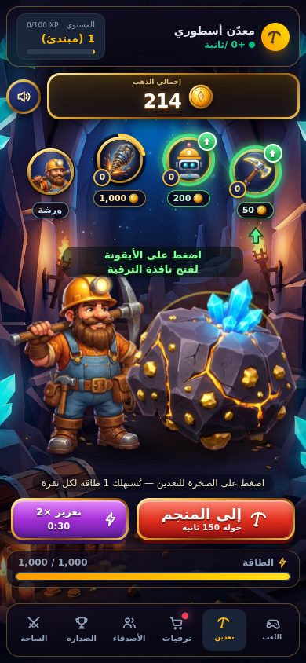
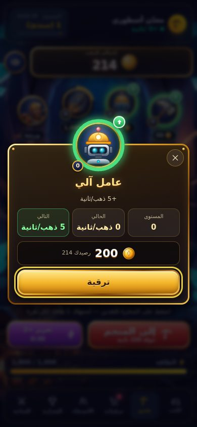
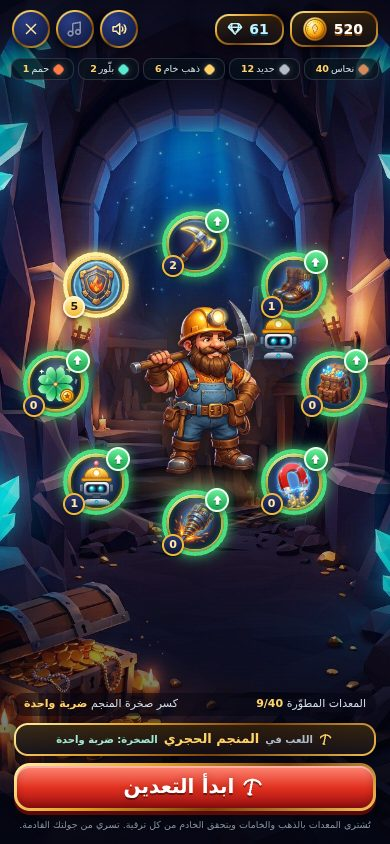

# مركز الكهف — تبويب التعدين والورشة بالفن المرسوم

طلب المستخدم أن تصبح شاشة التعدين «مثل هذا»، مرفقاً لقطة من لعبة تعدين أخرى (مشهد كهف، ميداليات ذهبية بحلقات تقدّم حول مدخل المنجم وحول روبوت، عدّاد ذهب مزخرف، سهم إرشاد، وزر أحمر كبير «إلى المنجم»). اعتُمدت اللقطة **إلهاماً للبنية والتفاعل فقط**: كل الفن هنا أصلي ومولَّد لهذا المشروع، بلا نصوص ولا شعارات ولا أيقونات منقولة.

| مركز الكهف | نافذة الترقية | الورشة |
| --- | --- | --- |
|  |  |  |

> **عميل فقط — لا اقتصاد ولا خادم.** الذهب والطاقة والعمليات كما هي (نقرة = طاقة واحدة، تعزيز ×2 لـ30 ثانية، تهدئة 5 دقائق، شراء الترقية عملية `buy` عادية يتحقق منها الخادم، والمعدات عملية `buy_equip`). الاستثناء الوحيد في `server.js` سطر واحد يخزّن صور `/assets/cave` أسبوعاً (انظر «التخزين المؤقت»).

## التفاعل

| العنصر | السلوك |
| --- | --- |
| **الصخرة والمعدّن** | اللمس على أيٍّ منهما يعدّن (نقرة واحدة = طاقة واحدة). الصخرة تميل ثلاثياً نحو موضع اللمس وتنضغط وتنبض؛ وميض وموجة وشظايا ذهب وصخر عند نقطة الضربة؛ المعدّن يميل نحو الصخرة؛ عروقها تتوهّج أكثر مع النقر المتواصل وتتلوّن بنفسجياً بالتعزيز وبالأحمر في «حمّى التعدين». لمس الزينة بين الميداليات لا يعدّن. |
| **الميداليات الأربع** | ثلاث ترقيات (فأس فولاذي، عامل آلي، منصة تعدين عملاقة) على قوس ضحل فوق الساحة + ميدالية الورشة. **حلقة التقدّم** = رصيدك ÷ سعر الترقية؛ حين يكفي الرصيد تخضرّ الحلقة ويظهر سهم أخضر؛ شارة المستوى (عدد المشتريات) وشريحة السعر تحتها؛ نقطة حمراء على تبويب الترقيات. |
| **نافذة الترقية** | تُفتح بلمس ميدالية: اسم، وصف، «المستوى / الحالي / التالي» (محسوبة بـ`base + owned × gain` كما يطبّقها `UPGRADES.apply`)، السعر والرصيد أو «ينقصك N»، وزر «ترقية» بنفس `buyUpgrade`. تبقى مفتوحة لسلسلة مشتريات؛ تُغلق بـEscape أو لمس الخلفية أو زر الإغلاق أو مغادرة التبويب؛ التركيز ينتقل إليها ويُحبس فيها ويعود إلى الميدالية. |
| **إرشاد أول مرة** | سهم أخضر ونص «اضغط على الأيقونة لفتح نافذة الترقية» تحت أول ميدالية جاهزة، حتى تُفتح أي نافذة (يُحفظ في `mining-fx-hint`). |
| **«إلى المنجم»** | الزر الأحمر الكبير: ينتقل إلى جولة المنصّات (150 ثانية) ويبدأها؛ وإن كانت هناك جولة موقوفة لا يستبدلها بل يترك للاعب «متابعة الجولة». |
| **ميدالية الورشة** | تفتح الورشة بملء الشاشة؛ تخضرّ مع سهم حين تكفي الأرصدة (ذهب + خامات) لترقية معدة. |
| **العدّاد والصوت** | عدّاد الذهب بإطار ذهبي مشطوف وعملة مرسومة، وزر كتم الصوت بجانبه (يظهر مع المشهد فقط). |

عند ارتفاع الشاشة ≤ 700px تُخفى ترويسة الملف الشخصي لتفسح المجال للمشهد؛ وفي العرض الأفقي القصير تصير الميداليات عموداً بجانب الصخرة والأزرار مكدّسة على الطرف الآخر.

## الورشة (نفس المجموعة)

مشهد الكهف خلف حلقة المعدات، وثماني ميداليات مرسومة (نفس مكوّن الميدالية: حلقة تقدّم بالذهب، أخضر عند الكفاية، ذهبي مكتمل عند المستوى الأقصى)، والمعدّن المرسوم في الوسط، ومسيّرة الروبوت (رسم متجهي) تظهر بجانبه عند ترقية «روبوت التعدين» كما كان رفيق اللوحة القديمة. بطاقة المعدة تعرض ميداليتها الكبيرة. بقيت كل مفاتيح الاختبار: `.ws-node` و`data-ws-item` و`.can-buy` و`.is-max` و`#ws-hero`.

## الفن (الأصول)

جميعها في `public/assets/cave/` (≈ 0.5MB مجتمعة، لا تُحمَّل خلفية المشهد قبل أول فتح للتبويب):

| الملف | الحجم | الاستعمال |
| --- | --- | --- |
| `cave-portrait.jpg` | 768×1376 · 134KB | خلفية الهاتف (نسبة العرض/الارتفاع < 1) |
| `cave-wide.jpg` | 1376×768 · 161KB | خلفية الشاشات العريضة والأفقية القصيرة |
| `hero.webp` | 421×560 شفاف · 55KB | المعدّن (ساحة التعدين + الورشة) |
| `ore.webp` | 520×520 شفاف · 45KB | صخرة الذهب التي تُنقر |
| `icons/{pickaxe,boots,bag,magnet,drill,armor}.webp` | 192×192 · 5–11KB | أيقونات الميداليات |
| `icons/miner.webp` | 192×192 · 8KB | ميدالية الورشة (وجه المعدّن) |

- **المصدر:** صور مولَّدة بأداة الصور في Arena بمطالبات أصلية (مشهد منجم منخفض الأوجه بقوس أزرق مضيء ومشاعل وبلّورات وصندوق كنز؛ معدّن قزم بخوذة ولحية ومعول؛ صخرة ذهب بعروق حمم وبلّورات زرقاء؛ أيقونات «فأس/حذاء/حقيبة/مغناطيس/مثقاب/درع» بخلفية كحلية متوهجة). لم تُغذَّ لقطة المرجع إلى أي أداة توليد.
- **المعالجة:** `scripts/art/process-art.py` — قصّ المعدّن والصخرة من خلفية خضراء مصمتة (ألفا ناعم + إزالة الانسكاب الأخضر)، قصّ الأيقونات مربعاً (نسب القص: معول 0.76، درع 0.80، حذاء 0.86، حقيبة 0.88، مثقاب 0.90، مغناطيس 0.92) وتصغيرها إلى 192، وإعادة ترميز الخلفيتين JPEG تدريجياً. الناتج قابل للاستنساخ بايتاً ببايت من الصور الخام.
- **بدائل متجهية** (في `#art-sprite` داخل `index.html`): **الروبوت** و**نبتة الحظ** و**عملة الذهب** مرسومة SVG بتدرجات، لأن حدّ توليد الصور في الدورة التي بُني فيها المشروع (10 صور) نفد قبل لوحتي الروبوت والنبتة. ترقيات النقر تستعير فن المعدات (فأس ← معول، منصّة ← مثقاب، عامل آلي ← روبوت).
- **استبدال/إضافة أيقونة:** ضع WebP بمقاس 192×192 في `icons/`، أضف اسمه إلى `PAINTED` في `public/cave-art.js` (ويُحذف من `VECTOR` إن وُجد)، ثم **ارفع رقم `?v=`** في كل مرجع لـ`/assets/cave` (يحرس اختبار أن الأرقام موحّدة وأن كل مرجع يحمل رقماً).
- **احتياط:** تحت كل صورة ميدالية أيقونة خطية من سبرايت الواجهة؛ إن تعذّر تحميل الصورة تُزال فتظهر الأيقونة الخطية. وإن غاب `cave-art.js` تُبنى الميداليات بالأيقونات الخطية، وإن غاب `clicker-fx.js` يعمل التعدين بالمسار القديم.
- **قاعدة الأيقونات:** الأيقونات الوظيفية (صوت، إغلاق، أسهم، شريط التنقل) تبقى SVG خطية؛ الفن المرسوم للميداليات والمشهد والشخصيات فقط، ولا يعتمد أي شيء على خطوط الإيموجي.

## التخزين المؤقت

`server.js` يرسل `Cache-Control: public, max-age=604800, immutable` لما تحت `/assets/cave/` وحده. هذا آمن لأن **كل مرجع يحمل `?v=<n>`** (HTML وCSS وJS)، ويفشل اختبار `test/clicker-fx.test.js` إن فُقد الرقم أو اختلف بين الملفات. `scripts/check-build.cjs` يتحقق الآن أيضاً أن كل صورة تطلبها ملفات CSS موجودة.

## الأداء والوصول

- الحركة بـ`transform`/`opacity` فقط؛ الجسيمات على Canvas واحد بحد 150 وكثافة 1 وتنام عند الخمول؛ عناصر DOM الأمامية ≤ 24؛ متغير الحرارة يُكتب على عنصر التوهّج وحده (لا على المشهد كله)؛ لا فلاتر ولا أقنعة ولا ظلال ضبابية على ما يُنشأ مع كل نقرة (وميض وموجة بـCSS صرف).
- مقاسات الصخرة والمعدّن من أبعاد الساحة نفسها (وحدات الحاوية `cqw/cqh` مع احتياط بالـ`vw`)، والزينة (الهالة والظل) مقصوصة بـ`overflow: clip` فلا تضيف شريط تمرير.
- `prefers-reduced-motion`: بلا إمالة ولا جسيمات ولا وميض ولا تنفّس ولا انتقال مشهد؛ تبقى الألوان والأرقام. ميداليات أزرار حقيقية مع `aria-label` يذكر السعر وإمكانية الشراء، ونافذة `role="dialog"` مع حبس تركيز وEscape.
- **قياس (Chromium برمجي بلا GPU «SwiftShader» بدقة 2×):** الخمول 58 إطاراً/ث؛ مع النقر 9 مرات/ث بين 12 و20 إطاراً/ث مقابل 23–33 للشاشة السابقة في البيئة نفسها، بينما زمن الخيط الرئيسي (سكربت + أنماط + تخطيط) متطابق تقريباً (≈ 0.5 ثانية من كل 3). أي أن الفرق في طبقات التركيب والرسم، وهو ما تتكفل به وحدة معالجة الرسوم في الهواتف. **لم تُجرَّب على جهاز Android ضعيف حقيقي**؛ يُنصح بتجربة واحد قبل الإطلاق، وإن ظهر بطء فالخطوة التالية «وضع خفيف» (إيقاف الغبار والتوهّج المتنفّس والضبابية) بصنف CSS واحد.

## الاختبارات

- `test/clicker-fx.test.js` (**41**): النماذج الصافية الجديدة (`arcLift`, `nodeView`, `sheetView`, `hintTarget`) والشظايا الصخرية وأصوات الواجهة؛ عقد «عرض فقط» (لا شبكة ولا حالة اقتصاد ولا استدعاء `apply` ومفاتيح التخزين الثلاثة فقط)؛ الأصول موجودة بأحجام معقولة والرموز المتجهية في السبرايت؛ تطابق الأثر المعروض في النافذة مع ما يضيفه `apply()`؛ بنية HTML/CSS؛ أسلاك البناء؛ مكوّن `CaveArt` (حقن الترميز، الاحتياط، الحالات)؛ التخزين المؤقت وأرقام النسخ.
- `test/page-boot.test.js` (**13**): الصفحة كاملة بوجود الملف وبدونه — حالات الميداليات، نافذة تشتري وتُبقي الاقتصاد مضبوطاً وتُغلق بمغادرة التبويب، ميدالية الورشة، «إلى المنجم» (يبدأ جولة ولا يستبدل الموقوفة ولا ينقر زراً معطّلاً)، ومتابعة المشهد للتبويب.
- `npm run test:clicker` (Chromium حقيقي، في CI): الصور تُحمَّل فعلاً والمشهد الصحيح لكل شكل شاشة، إمالة وحسابات مضبوطة، لمس حقيقي على الصخرة وعلى المعدّن وتجاهل الزينة، حمّى، طاقة، لوحة مفاتيح، تعزيز (توهّج بنفسجي)، حلقة التقدّم والسهم والإرشاد، شراء من النافذة يقبله الخادم ويتفق معه الرصيد، إغلاقها بالثلاث طرق، ميدالية الورشة، «إلى المنجم» (بدء ثم متابعة دون استبدال)، حركة أقل، و6 مقاسات + 821×934 (نافذة الترقية والورشة تتسع في كلٍّ منها).

## حدود معروفة وما بعدها

- الروبوت والنبتة متجهيان (انظر أعلاه) ويمكن استبدالهما بلوحتين مرسومتين بإسقاط ملفين.
- الصوت والاهتزاز واللمس الحقيقي على Telegram ومعدّل الإطارات على أجهزة ضعيفة لا يمكن التحقق منها في هذه البيئة.
- شاشة «اللعب» (لوحة بدء الجولة) والمتجر وخريطة المناجم بقيت بمظهرها السابق؛ تمديد المجموعة إليها (خلفية الكهف وميداليات المناجم) هو الخطوة الطبيعية التالية.
- المرحلة 4 (الاقتصاد الخادمي) ما زالت بانتظار موافقتك.
