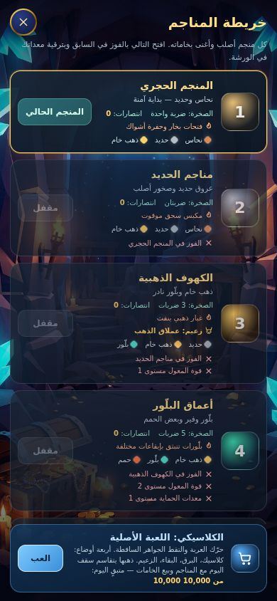

# الوضع الكلاسيكي: اللعبة الأصلية تعود من خريطة المناجم (الدفعة 3أ′)

اللعبة الأصلية (حرّك العربة والتقط الجواهر الساقطة وتفادَ الصخور والقنابل) كانت مخفية خلف منجم المنصّة ولا تظهر إلا في السباقات.
بعد اعتماد المستخدم (خيار `shared_cap`) صارت ظاهرة من **خريطة المناجم** بجوائزها الحالية نفسها، **لكن تحت سقف الذهب اليومي المشترك (10,000 لكل لاعب في اليوم)**.
· `test/classic-cap.test.js` (11 اختباراً، خادم) · `test/classic-mode.test.js` (7، ربط الصفحة) · `scripts/test-classic-browser.cjs` (`npm run test:classic`، متصفح حقيقي، خطوة سادسة في CI).

## ماذا يرى اللاعب

- في أسفل **خريطة المناجم** (زر «اللعب في» في شاشة الجولة) بطاقة زرقاء ثابتة: «الكلاسيكي: اللعبة الأصلية» وزر **العب**، وتحتها كم بقي من سقف اليوم. ليست بطاقة سابعة بين المناجم (خارج `#mines-list` ولها صنف خاص)، فعدّ المناجم الستة في اختبارات المتصفح الأخرى لم يتغيّر.
- الزر يغلق الخريطة ويفتح لوحة الكلاسيكي بأوضاعها الأربعة (كلاسيك، البرق، البقاء، الزعيم) كما كانت. في أعلاها صفّ جديد: زر **العودة إلى المنجم** وسطر **سقف اليوم المشترك: متبقٍ X من 10,000**.
- العودة وسط جولة **توقفها مؤقتاً ولا تنهيها**: تعود من الخريطة نفسها فتجدها موقوفة. وشاشة المنصّة تعمل بعد الرحلة (يتحقق الاختبار من بدء جولة منصّات بعدها).
- لا يُعرض زر العودة أثناء **سباق**، والدخول نفسه يُتجاهل أثناءه: السباق يُغادَر بمساره المعتاد فقط، ولم يتغيّر شيء في `startAdventure('race', …)`.
- نهاية الجولة تعرض **ما سيدفعه الخادم فعلاً** لا رقماً يُصحَّح لاحقاً: إن لم يكفِ الباقي من السقف قالت «دُفع لك الباقي فقط (50 من 80)»، وإن انتهى قالت «لا ذهب إضافي اليوم (كان 80)»، مع وقت تجدّد السقف **بساعة جهازك** (يتجدّد 00:00 UTC، أي **03:00 فجراً بتوقيت اليمن والسعودية**). ورسالة المزامنة تقول الشيء نفسه بعد ردّ الخادم.

## ما يفعله الخادم (`server.js`، `applyRun`)

الجائزة كما كانت: من النقاط التي يسمح بها زمن اللعب، بسقف الوضع (كلاسيك 100، برق 100، بقاء 150، زعيم 100، و+150 لقتل الزعيم)، وفاصل 20 ثانية بين جولتين مكافأتين. **ثم** يمر الذهب بالسقف اليومي المشترك:

| الحالة | ما يحدث |
| --- | --- |
| الباقي يكفي | تُدفع كاملة، وتُخصم من المحفظة المشتركة `sync.platformGold` |
| الباقي أقل من الجائزة | يُدفع الباقي فقط، `reason: 'daily_cap'`، والقيد في السجل عليه `capped: true` |
| المحفظة فارغة | لا ذهب، `reason: 'daily_cap'`، **والجولة تُحتسب** (إحصاءات، خبرة، مهام، قتل زعيم) لأن السقف يقصّ **الذهب فقط** |
| جولة سباق | لا ذهب أصلاً ولا تلمس المحفظة (للمجد) |
| جولة «متسارعة» (أقل من 20 ثانية) | `too_soon` كما كانت، ولا تستهلك من المحفظة |
| إعادة إرسال الدفعة نفسها | `duplicate` ولا تُخصم مرتين |
| يوم UTC جديد | تُصفَّر المحفظة عند أول دفع في اليوم |

- **المحفظة واحدة** مع جولات المنصّات وبيع الخامات (`dailyQuota` نفسها): جولة كلاسيكية تستهلك ما يمكن بيعه من الخامات في اليوم، والعكس (يثبته الاختبار بالاتجاهين).
- فاصل الـ20 ثانية **لا يتقدّم إلا حين يُدفع ذهب فعلاً**: جولة بلا دفع لا تؤخّر التي بعدها.
- الردّ يحمل `dailyRemaining` للجولة، وكل ردّ `/api/ops` و`/api/me` يحمل `dailyGold: { day, used, cap, remaining }` (قراءة فقط، دالة `dailyGoldView` الصافية: لا تكتب ولا تُصفّر).
- **ثغرة قديمة أُغلقت**: مسار `run` قائم على ما يدّعيه العميل (لا إعادة تشغيل كجولات المنصّات)، وكان **بلا سقف يومي** رغم أن الواجهة كانت مخفية: عميل معدَّل كان يستطيع إرسال جولات «بقاء» قصيرة أو «زعيم» كل 20 ثانية (150–250 ذهباً لكل جولة) فيبلغ نظرياً نحو **650 ألفاً إلى مليون ذهب يومياً**. صار مجموعه مع كل ما سبق **10,000 كحد أقصى**. (الدخل السلبي `بوت×5 + حفّارة×25` ذهب/ثانية يبقى أكبر من أي جائزة مغامرة بمراحل، وهذا خارج هذه الدفعة.)

## المهام التي عادت

كانت مهمتا **«اهزم زعيماً»** و**«نقاط في وضع البقاء»** مستبعدتين من السحب لأن لا شيء ظاهراً يغذّيهما (كانتا تظهران مستحيلتين في ~49% من الأيام). بعد ظهور الكلاسيكي عادتا إلى المجموعتين اليومية والأسبوعية (11 من 11):

| المهمة | يومية | أسبوعية | تتقدّم من |
| --- | --- | --- | --- |
| اهزم زعيماً | 300 ذهب + 80 خبرة (مرة) | 900 ذهب + 220 خبرة (3 مرات) | وضع الزعيم الكلاسيكي **وزعيما** منجمي الذهب والقلب |
| نقاط في البقاء | 250 ذهب + 60 خبرة (250 نقطة) | 700 ذهب + 180 خبرة (400 نقطة) | وضع البقاء الكلاسيكي |

عناوينهما تذكر مصدرهما («الكلاسيكي أو منجم الزعيم»). **هذا أثر مباشر لقرار إظهار الكلاسيكي لا قرار مستقل**، وإرجاعه سطر واحد: إعادة المفتاحين إلى مجموعة تُستبعد من `pickMissions`. الجائزتان تُصرفان بعملية `mission` / `weekly_mission` كغيرهما (خارج سقف المنصّات، كحال كل المهام)، والمهام المخزّنة سابقاً بقيت صالحة (اختبار).

## ما لم يتغيّر (وما يجب أن تعرفه)

- **اللعبة الكلاسيكية نفسها بإيموجيها الأصلي** (🪙 💎 🛡️ …)، لأنك طلبت إبقاء المغامرة القديمة كما هي. هذا يخالف تفضيل الأيقونات SVG في بقية التطبيق. عناصر الدخول والعودة وبطاقة الخريطة **SVG بلا إيموجي** (يحرسها اختبار). تحويل الكلاسيكي نفسه إلى SVG عمل منفصل أعرضه عليك إن أردت.
- الأيقونات في لقطة الاختبار تظهر مربعات فارغة لأن متصفح الاختبار بلا خط إيموجي؛ لذلك لا تُلتقط لوحة الكلاسيكي في التوثيق.
- وقت تجدّد السقف يحسبه الخادم بـ UTC دائماً؛ العرض فقط بساعة الجهاز.

## الاختبارات

- **`classic-cap.test.js`** (11): العرض الصافي (لا يكتب، يوم قديم = فارغ، UTC مهما كان توقيت الجهاز)، دفع كامل، دفع جزئي، محفظة فارغة (الإحصاءات والخبرة تبقى، والفاصل لا يتقدّم)، المحفظة المشتركة بالاتجاهين مع بيع الخامات، دفعة واحدة (كامل ثم جزئي ثم لا شيء)، تبدّل اليوم، السباق و`too_soon`، مكافأة الزعيم المقصوصة مع بقاء القتل والمهمة، التكرار.
  **22 طفرة في `server.js` و`platform-api.js`، قُتلت كلها** (نجت واحدة أولاً: لا شيء يميّز اليوم UTC عن المحلي في بيئة توقيتها UTC، فأُضيف اختبار يضبط `TZ=Asia/Riyadh` ويتحقق).
- **`missions.test.js`**: المجموعتان كاملتان من جديد (11 من 11 على 54 لاعباً، احتمال الغياب ≈ 4e-8)، وجولات الكلاسيكي تقدّم المهمتين وتُستلمان (يومي وأسبوعي)، والمخزَّنة سابقاً صالحة.
- **`classic-mode.test.js`** (7): موضع البطاقة وصنفها، لوحة العودة، المعالجات وحراسة السباق، تبنّي المحفظة والمعاينة، الرسالة قبل `too_soon`، الأنماط، وما بقي كما هو. **25 طفرة في الصفحة والأنماط، قُتلت كلها.**
- **`npm run test:classic`** (متصفح حقيقي): لاعب جديد يجد البطاقة، يدخل، يبدأ جولة، يغادرها (موقوفة لا ضائعة) ثم يعود ويكملها فيدفع الخادم 80 ويخصمها؛ ثم محفظة بـ50 فقط (يُدفع 50 ويقول «50 من 80»)، ثم فارغة (لا ذهب، تُحتسب جولة)؛ وجولة منصّات تعمل بعد الرحلة؛ وزر العودة مخفي أثناء السباق؛ وعناصره SVG؛ و320×568 و390×844 و844×390 بخط الجهاز وبعد تباعد الحروف 1px.

## حدود ما اختُبر

لم يُجرَّب على جهاز لمس حقيقي ولا داخل تيليجرام، ولا سباق حيّ بين لاعبين (حراسة السباق مثبتة من الشيفرة والسلوك على الحالة المحاكاة فقط). مسارات PostgreSQL تُختبر في CI فقط.
