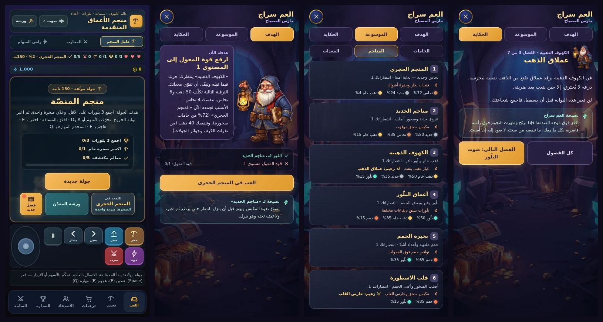

# المرشد «العم سراج»: الهدف والموسوعة والحكاية

الدفعة **3أ** من الخيار 3 (القصة والموسوعة). **عرض فقط**: لا ذهب ولا خامات ولا عمليات ولا خادم ولا تغيير في الاقتصاد.
يقرأ حالة اللاعب (`state.equipment` و`state.mines` و`state.ores` و`state.gold`) وقواعد المنصّة المشتركة (`public/platform-rules.js`)،
ولا يحفظ على الجهاز إلا شيئاً واحداً: **أي الفصول قرأها**.

الملفات: `public/guide.js` (النموذج والواجهة) · `public/guide.css` · `public/assets/cave/guide/siraj.webp` (صورة العم سراج، 428×520، 52KB، قصّتها شفافة)
· `test/guide.test.js` (33 اختباراً) · `scripts/test-guide-browser.cjs` (`npm run test:guide`).

## ماذا يرى اللاعب

- في شاشة الجولة زرّ **«المرشد»** بجانب «ورشة المعدّن» (يظهر بعد أن يعتمد التطبيق حالة الخادم). عليه **نقطة حمراء** لمن لم يفتحه قط أو لديه فصل لم يقرأه.
- النافذة بثلاثة أقسام:
  - **الهدف**: العم سراج يقول ماذا تفعل الآن ولماذا، وقائمة بالشروط الناقصة (✓/✗ برموز SVG) وزرّ ينفّذ الخطوة، ونصيحة للمنجم المختار حالياً.
  - **الموسوعة**: الخامات (سعر البيع وأين تُوجد بنسبها) والمناجم (الشروط، والخطر المميّز والزعيم بعد الفتح) والمعدات الثماني (الأثر الآن وسعر الترقية التالية).
  - **الحكاية**: سبعة فصول (فصل لكل منجم وخاتمة)، المغلق منها يذكر شرط فتحه.
- حين يُفتح منجم جديد يتحوّل الزر نفسه إلى **«فصل جديد»** (ذهبي) ويفتح الفصل مباشرة. لا شريط إضافي: شاشة الجولة على جوال 390×844 تتسع لمحتواها بالكاد
  فكل سطر زائد كان يدفع صفّ الأزرار خارجها (قِيس وأُصلح أثناء البناء). الفصل الأول لا يرفع الزر؛ تعرّف به النقطة الحمراء وحدها.
- يوقف الجولة الجارية مؤقتاً عند الفتح، ويعيد التركيز إلى الزر عند الإغلاق (Escape أو زر الإغلاق)، والجولة الموقوفة تبقى هي نفسها.

## كيف يختار «الهدف التالي» (`Guide.nextGoal`)

1. لم يفز بالمنجم الأول: «اعبر المنجم الحجري».
2. وإلا فأول منجم **مقفل بالترتيب** هو الهدف، والشرط الناقص الأول كما تسرده الخريطة: **الفوز يسبق المعدات**.
   - فوز ناقص: «افز في X» (مع تنبيه أن زعيماً يحرس بوابة X إن كان فيه زعيم)، وزرّ «العب في X» يختار المنجم (لا يبدأ الجولة).
   - معدّة ناقصة: «ارفع X إلى المستوى N» بسعر الترقية **من القواعد المشتركة** (`R.equipCost`). إن كفت الأرصدة فعلاً فالزر «افتح الورشة وابدأ الترقية»،
     وإن لم تكفِ فالنص يقول ما ينقص (خامات وذهباً) وأنسب منجم **مفتوح** لجمع الخام (أعلى نسبة في `weights`)، والزر يختار ذلك المنجم.
3. كل المناجم مفتوحة والحارس لم يسقط: «اهزم حارس القلب».
4. وبعد إضاءة القلب: «قوِّ» أضعف معدّة (الأقل مستوى، والترتيب المشترك يفكّ التعادل).
5. كل شيء بلغ الأقصى: «أنت أسطورة المنجم».

**ضمان التقدّم**: اختبار يتبع المرشد خطوة بخطوة (يفوز حيث يقول، ويشتري حين يكفي، ويجمع الناقص حين لا يكفي) من **250 حالة ابتدائية** حتى «أسطورة المنجم»،
ويتأكد في كل خطوة أنه لا يكرّر نفسه بلا تقدّم، ولا يوجّه إلى منجم مقفل، ولا يقترح الورشة إن لم تكفِ المحفظة (يفحص المحفظة بنفسه لا بعَلَم المرشد).

## الموسوعة: ما يُكشف وما يبقى لغزاً

- **الخامات**: خام يُعدّ «مكتشفاً» إن امتلكتَ منه شيئاً أو فتحتَ منجماً يُنتجه؛ غير ذلك يظهر «؟؟؟» مع اسم أول منجم يُنتجه.
  (الأول يُنتج النحاس والحديد والذهب الخام، فالبلّور والحمم لغز حتى فتح الكهوف الذهبية وأعماق البلّور.)
- **المناجم**: المقفل يعرض شروطه (✓/✗ حية) وإن كان يحرسه زعيم، ولا يكشف خطره ولا اسم زعيمه حتى يُفتح.
- **المعدات**: المستوى والأثر الحالي والتالي وسعر الترقية، كلها من `R.effectText` و`R.equipCost`.
- نص الخطر لكل عالم هو نفسه نص خريطة المناجم (اختبار يمنع انحراف الاثنين).

## الحكاية

| الفصل | العنوان | يُفتح مع | نصيحته (تطابق ما يفعله المحرك، واختبار يربطها بمستويات `R.levelFor`) |
| --- | --- | --- | --- |
| 1 | المصباح الأول | المنجم الحجري | بخار الفتحات ينفث على فترات: عدّ معه واعبر حين يهدأ |
| 2 | المكبس القديم | مناجم الحديد | يصفرّ ضوء المكبس ويهتز قبل أن ينزل |
| 3 | عملاق الذهب | الكهوف الذهبية | اقفز فوق موجة الصدمة، واضربه حين يترنّح |
| 4 | صوت البلّور | أعماق البلّور | إيقاعان مختلفان للبلّورات: راقب الأول ثم انتظر الثاني |
| 5 | نار تحت الجسر | بحيرة الحمم | اقفز عندما تهدأ النافورة لا حين تغلي |
| 6 | حارس القلب | قلب الأسطورة | ابتعد عند إنذار الاندفاع ثم اقفز حين يقترب |
| 7 | المصباح لا ينطفئ | هزيمة حارس القلب (الفوز في المنجم السادس) | الخاتمة |

العنوان الثالث والسادس هما اسما الزعيمين في القواعد حرفياً (اختبار يقارنهما)، فإن تغيّر اسم زعيم فشل الاختبار بدل أن تنحرف الحكاية.

## ما يحفظه الجهاز

المفتاح `mining-guide` في `localStorage`: `{ v: 1, seen: [أرقام الفصول المقروءة], opened: true|false }`، ولا يُكتب شيء آخر (اختبار يسجّل كل `setItem`).

- يُنشأ **بعد اعتماد حالة الخادم** (`platformReady`)، لا قبلها، وإلا بدا اللاعب القديم جديداً.
- لاعب لديه تقدّم قبل هذه الميزة (أي فوز أو معدّة أو خام) تُعدّ فصوله المفتوحة **مقروءة** فلا تنهال عليه «فصول جديدة»؛ تبقى النقطة الحمراء مرة واحدة تعلن عن الميزة،
  وكل فصل يُفتح بعد ذلك يظهر جديداً.
- تلف التخزين أو منعه لا يكسر شيئاً: يعمل المرشد ولا يتذكر.

## تعديل النصوص أو إضافة فصل

كل النصوص في `CHAPTERS` داخل `public/guide.js`. فصل جديد لمنجم سابع يحتاج: عنصراً في `R.MINES` (ومستوىً في `R.LEVELS`) وعنصراً في `CHAPTERS` وسطراً في `DANGER`؛
واختبارات التكامل (فصل لكل منجم بالترتيب، `DANGER` يغطي كل منجم، الخاتمة الأخيرة) تفشل إن نُسي أحدها.
تغيير صورة العم سراج: `python3 scripts/art/process-art.py key raw.png public/assets/cave/guide/siraj.webp --height 520` ثم غيّر `?v=` في `PORTRAIT`
(اختبار يوحّد رقم الإصدار مع بقية فن الكهف).

## الاختبارات

- `test/guide.test.js` (**33**): سلامة الفصول والنصائح مقابل المحرك، فتح الفصول بالمناجم والخاتمة، تتبّع القراءة وترحيل اللاعب القديم، تلف التخزين،
  سيناريوهات الهدف كلها، نسب الخامات وأنسب منجم، **محاكاة اتباع المرشد حتى النهاية**، المدخلات المشوّهة، الموسوعة (الكشف والإخفاء)، **تعقيم كل اسم يصل إلى الصفحة**
  (اسم منجم خبيث يبقى نصاً)، واجهة بـ DOM وهمي (الفتح والإيقاف المؤقت والتركيز وEscape والتبويبات والزر وأفعال الهدف وإعادة الرسم أثناء الفتح)،
  أنه **للقراءة فقط** (لا `fetch` ولا كتابة غير مفتاحه ولا يلمس الحالة)، والربط بالصفحة (الترتيب والعلامات والأنماط)، والصورة (مقاسها وحجمها).
- **اختبار الطفرات: 82 طفرة في `guide.js` والصفحة والأنماط، قُتلت كلها** (نجت منها خمس عبر جولتين فكشفت ثغرات في اختباراتي أُصلحت:
  لاعب بمعدّات بلا خامات، «يكفي الذهب وتنقص الخامات»، التعقيم، إعادة الرسم أثناء الفتح، توجيه الزر لفصل غير الأول).
- `npm run test:guide` (متصفح حقيقي، في CI): لاعب جديد يفتح النافذة ويقرأ الأقسام الثلاثة وفصلاً ثم تختفي النقطة بعد إعادة التحميل؛ ثم يُنقل تقدّمه عبر SQLite فيظهر «فصل جديد»
  ويفتح الزر الفصل نفسه، وهدف الفوز والمعدّة (الورشة تُفتح فعلاً، أو يُختار المنجم)، ولاعب قديم لا تنهال عليه الفصول وتنفتح له الخاتمة والموسوعة كلها، وجولة موقوفة تبقى موقوفة،
  والتحقق أن المرشد لا يكتب للخادم ولا يغيّر الذهب والطاقة، وأنه لا يضيف ارتفاعاً لشاشة الجولة، ومقاسات 320×568 و390×844 و844×390 بلا تمرير جانبي وبأزرار قابلة للوصول.

## حدود معروفة

- **عميل فقط**: ما قرأه اللاعب محفوظ على جهازه، فجهاز جديد يرى الفصول المفتوحة «مقروءة» (لاعب قديم) أو «جديدة» (حساب بلا تقدم)؛ لا مزامنة بين الأجهزة.
- طلب فصل مغلق برمجياً (`Guide.open('story', 6)`) يعرض القائمة ولا يكشف الفصل، لكنه يعدّه مقروءاً؛ لا يضر لأن الواجهة لا تعرض مغلقاً.
- النصوص كتبتها لتناسب نبرة اللعبة؛ لم يراجعها ناطق أصلي آخر غيري. الصورة مولَّدة بالذكاء الاصطناعي ومعالَجة بنفس خط الفن الحالي.
- لم يُجرَّب على جهاز لمس حقيقي ولا داخل تيليجرام.
- «الوضع الكلاسيكي» (اللعبة الأصلية المخفية) **لم يُكشف بعد**؛ هو بند منفصل من الخيار 3.
