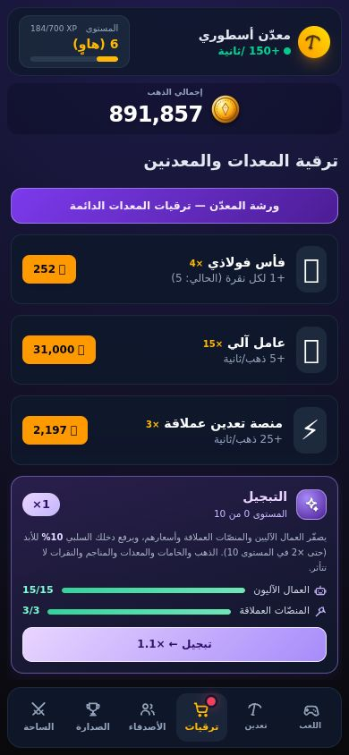

# التبجيل: دخل سلبي أكبر مقابل البدء من جديد بالعمال والمنصّات (الدفعة 3ج)

بعد اعتماد المستخدم (خيار `mild`): **+10% من الدخل السلبي لكل مستوى، حتى 10 مستويات (×2)**. المستوى الأول يلزمه **15 عاملاً آلياً و3 منصّات عملاقة**، والمتطلب يرتفع مع كل مستوى.
يصفّر **العمال والمنصّات وأسعارهم فقط**؛ الذهب والخامات والمعدات والمناجم والنقرات وترقيات المغامرة والخبرة والمهام والإنجازات لا تُمَسّ. عملية خادمية واحدة موقَّعة.
· `public/prestige-rules.js` (قواعد مشتركة بين الخادم والواجهة) · `test/prestige-rules.test.js` (8) · `test/prestige-api.test.js` (9) · `test/prestige-ui.test.js` (7) · `+2` في `client-sync.test.js` · `scripts/test-prestige-browser.cjs` (`npm run test:prestige`، خطوة ثامنة في CI).

## القواعد

- **الدخل السلبي = (عمال + 5 × منصّات) × (10 + مستوى) / 2** ذهب/ثانية. أعداد صحيحة ثم قسمة على 2، فالناتج من مضاعفات 0.5 ويُمثَّل بدقة في الفاصلة العائمة (لا `82.50000000000001` من `75 × 1.1`). **المستوى 0 يطابق الصيغة القديمة تماماً** (`عمال×5 + منصّات×25`)، ومستوى 10 ضعفها بالضبط، وكل مستوى يضيف عُشر الأصل بالضبط (اختبارات).
- **المتطلب للانتقال من المستوى L إلى L+1**: `15 + 2L` عاملاً و`3 + L` منصّة. لا متطلب بعد المستوى 10.
- التبجيل **لا يعطي ذهباً ولا خبرة**؛ الفائدة الوحيدة المضاعِف.

| المستوى الحالي → التالي | عمال | منصّات | ذهب لشراء هذا العدد من الصفر | الدخل عنده (ذهب/ث) | استرداد الـ+10% (ساعات) |
| --- | --- | --- | --- | --- | --- |
| 0 → 1 | 15 | 3 | 81,007 | 150 | 1.5 |
| 1 → 2 | 17 | 4 | 157,604 | 203.5 | 2.4 |
| 2 → 3 | 19 | 5 | 306,281 | 264 | 3.9 |
| 3 → 4 | 21 | 6 | 595,799 | 331.5 | 6.5 |
| 4 → 5 | 23 | 7 | 1,160,800 | 406 | 11.1 |
| 5 → 6 | 25 | 8 | 2,265,014 | 487.5 | 19.4 |
| 6 → 7 | 27 | 9 | 4,425,131 | 576 | 34.1 |
| 7 → 8 | 29 | 10 | 8,653,575 | 671.5 | 60.9 |
| 8 → 9 | 31 | 11 | 16,934,329 | 774 | 109.4 |
| 9 → 10 | 33 | 12 | 33,155,512 | 883.5 | 198.1 |

(الذهب من أسعار المتجر نفسها: العامل 200 ×1.4 لكل شراء، والمنصّة 1000 ×1.3. «الاسترداد» = زمن إعادة شراء هذا العدد من الصفر مقسوماً على عُشر دخله، **ليس وعداً**: اللاعب يحتفظ بذهبه فيعيد الشراء فوراً، فالتكلفة الحقيقية هي النزول المؤقت في الدخل.) المستويات الأولى تُسترد خلال ساعات، والأخيرة هدف طويل (أيام): **تبجيل متأخر خيار لا واجب**. اختبار يثبّت أن كلفة كل مستوى أعلى من سابقه بأقل من ×2.1 وأن العاشر أقل من 50 مليوناً.

## ما يحدث عند التبجيل (`prestige`)

| يُصفَّر | لا يُمَسّ |
| --- | --- |
| العمال الآليون، المنصّات العملاقة، سعر كل منهما (يعود 200 و1000) | الذهب (ما تراكم قبل لحظة التبجيل يُدفع بالمضاعف القديم أولاً)، الخامات، المعدات، انتصارات المناجم، النقرات وسعرها وقوتها، ترقيات المغامرة، الخبرة والمستوى، مهام المغامرة والإنجازات والمهام اليومية، المحفظة اليومية |

- **الخادم**: عملية `prestige` مرقّمة. غير مستوفية: `rejected` بسبب `locked` (مع `need` و`have` و`level`) أو `max`، **ولا تُحتسب مخالفة** ولا قيداً. مستوفية: يُصفَّر ما سبق، يرتفع المستوى، تُعاد الأسعار والدخل من `deriveStats`، وقيد `prestige` في الدفتر `{from, to, bots, rigs, multiplier}` بذهب صفر.
- **لا تتكرر**: العملية نفسها بالتسلسل نفسه `duplicate`؛ ثلاث عمليات في دفعة واحدة = واحدة وثنتان `locked` (لا شيء بقي ليُصفَّر)؛ وتبويبان في اللحظة نفسها يسلسلهما قفل معاملة اللاعب فيمرّ واحد. اختبارات (منها طلبان متوازيان فعلاً).
- **المستوى يكتبه الخادم وحده**: يُقرأ من حالته المخزّنة ويُقصّ (0..10 مهما خُزّن)، ولا يقبله من العميل (حتى `/api/save` القديمة)، وحقول إضافية في العملية لا تمنح شيئاً.
- **الإنجاز «اشترِ 10 ترقيات»** يحسب ما تخلّى عنه اللاعب (`spentBy`) كي لا يتراجع تقدّمه حين يُصفَّر المخزون.
- الدخل يمرّ بكل مسارات التراكم نفسها: التسوية المتصلة، والغياب (حتى 8 ساعات)، والتعزيز ×2 (اختبار: 100 ثانية بدخل 65 = 6,500).

## ما يراه اللاعب

- بطاقة بنفسجية في **تبويب الترقيات** تحت «منصة تعدين عملاقة»: المستوى من 10 والمضاعف الحالي، **سطران بشريط تقدّم** (العمال والمنصّات: ما يملكه وما يلزمه، والمستوفى أخضر)، والزرّ بأربع حالات: «يلزمك 15 عاملاً و3 منصّة» (معطّل)، «تبجيل ← ×1.1»، «اضغط مرة أخرى للتأكيد: يُصفَّر 15 عاملاً و3 منصّة»، «المستوى الأقصى ×2».
- **لمستان**: الأولى تسأل فقط (التصفير لا يحدث بلمسة واحدة) والسؤال يزول وحده بعد 6 ثوانٍ ولا ينتقل إلى لمسة متأخرة؛ الثانية تنفّذ. **التصفير يظهر على الصفحة فوراً** والخادم يؤكده («تبجيل مُعتمد: المستوى 1 — دخلك السلبي ×1.1»)، ويتراجع إن رفضه.
- أثر كل عامل ومنصّة في المتجر ونافذة الترقية يتبع المستوى (5.5 و27.5 في المستوى 1)، وشريط الدخل يعرض الأنصاف (`+165` و`+6.5`) لا قيمة مقصوصة.
- بلا خادم لا تبجيل (الزر معطّل ويشرح السبب): الخادم هو ما يجعله حقيقياً.
- البطاقة بلا إيموجي (يحرسها اختبار)، وتتّسع للجوال 320×568 و390×844 والأفقي 844×390 في الحالات الأربع بخطين.

## الاختبارات

- **`prestige-rules.test.js`** (8): دقة الدخل (المستوى 0 = الصيغة القديمة، +10% بالضبط لكل مستوى، مضاعفات 0.5)، المدخلات التالفة، المضاعف، جدول المتطلبات، الفحص (ناقص بوت أو منصّة، المساواة تكفي، القمة)، `spentBy`، العرض، **وسعر المتطلب من قواعد المتجر نفسها**.
- **`prestige-api.test.js`** (9، خادم حقيقي): المستوى 0 هو الاقتصاد القديم، الرفض (4 حالات بلا مخالفة ولا قيد)، التبجيل الأول (كل ما لا يُصفَّر مقارَن بعد/قبل بما فيه المهام والمحفظة)، الشراء بعده بالأسعار الأولى، **المستويات العشرة بالتتابع** (كل مستوى برفض ناقص-بوت وناقص-منصّة ثم قبول ثم رفض القمة)، التكرار (3 صور)، التراكم (غياب 100 ث، ودفع المدة السابقة للتبجيل بالمضاعف القديم 9,000 لا 9,900)، الإنجاز، والقيم التالفة والتزوير.
- **`prestige-ui.test.js`** (7): دوال الصفحة الفعلية بعناصر وهمية: الحالات الأربع، اللمستان وانتهاء السؤال، عدم التنفيذ دون خادم أو بنقص، عدم إعادة الرسم دون تغيّر، وربط الصفحة. **`client-sync.test.js`** (+2): المعاينة المحلية بقاعدة الخادم وتطبيقها فوق حالته حتى يؤكَّد ثم تراجعها إن رُفضت. وعُدّل اختبار `clicker-fx` ليشغّل جدول المتجر فعلاً (كان يقرأ أرقاماً بنمط نصي لا يرى الدوالّ الجديدة): وكشف فوراً أن `5 × 1.1` تعطي `5.500000000000001`، فصار الأثر المعروض بحساب القواعد نفسها.
- **طفرات**: 40 في القواعد والخادم و28 في الصفحة، **قُتلت كلها** عدا واحدة مكافئة (الحدّ الأعلى للمستوى مفروض مرتين: عند التحميل وفي `deriveStats`)، ونجا اثنان أولاً في الصفحة فكشفا ثغرتين في اختباراتي (سطر المتجر الذي يتبع المستوى، تفرّد المعرّفات).
- **`npm run test:prestige`** (متصفح حقيقي، 45 ثانية): بطاقة مقفلة للاعب جديد، ثم **14 عاملاً → شراء الخامس عشر بلمسة → تصير جاهزة → لمسة تسأل فقط → السؤال ينقضي وحده → سؤال وتأكيد → التصفير على الصفحة فوراً → الخادم يؤكد (كل شيء آخر مقارَن) → بعد إعادة التحميل كما هو**، ثم الدخل (165 للمخزون الذي كان 150، و5.5 و27.5، وعامل واحد في المستوى 3 = 6.5 والخادم يوافق)، والقمة (×2 ومعطّل)، والجوالات الثلاثة بخطين في الحالات الأربع (لا تراكب في الرأس ولا صفوف المتطلبات، الشريط بطول ظاهر، نص الزر غير مقصوص).

## ما لم يُفعل وحدود ما اختُبر

- لا شارة على التبويب حين يصير التبجيل جاهزاً (الزر يتغيّر داخل البطاقة فقط).
- المرشد «العم سراج» لا يعرف التبجيل (للقراءة فقط عمداً).
- الأرقام (15/3 وخطوة 2/1 ومضاعف 10%) أرقام التصميم المعتمد؛ كلها في `prestige-rules.js` وأي تغيير فيها يعدّل اختباراً يثبّتها حرفياً.
- لم يُجرَّب على جهاز لمس حقيقي ولا داخل تيليجرام. مسارات PostgreSQL تُختبر في CI فقط.
- الدخل السلبي يبقى أكبر من أي جائزة مغامرة بمراحل (نقطة سبق ذكرها)؛ التبجيل يزيدها 10% لكل مستوى فلا يعالج هذا.
