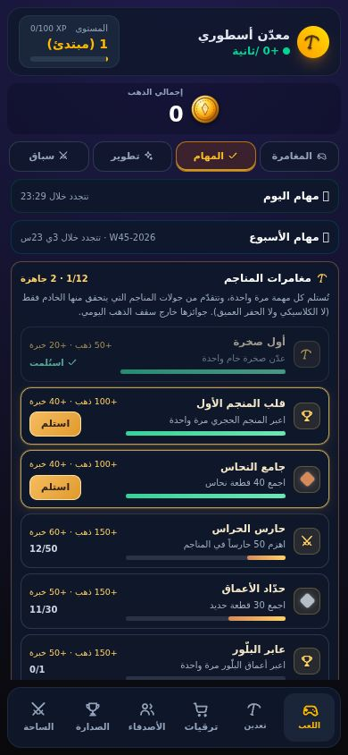

# مهام المغامرة: اثنتا عشرة مهمة تُستلم مرة واحدة (الدفعة 3ب)

بعد اعتماد المستخدم (خيار `small`): نحو 12 مهمة مغامرة لمرة واحدة، **مجموعها 2,500 ذهب و800 خبرة**، وعدّاداتها من **جولات المنصّات التي أعاد الخادم تشغيلها فقط**.
· `quests.js` (وحدة صافية) · `test/quests-rules.test.js` (7) · `test/quests-api.test.js` (8) · `test/quests-ui.test.js` (5) · `scripts/test-quests-browser.cjs` (`npm run test:quests`، خطوة سابعة في CI) · وامتداد في `test:bosses`.

## ماذا يرى اللاعب

- في **لوحة المهام** (تبويب اللعب ← المهام) صندوق ثالث بعد مهام اليوم والأسبوع: **«مغامرات المناجم»**، مطويّ في البداية. ملخصه يعرض `المنجز/12`، ويصير ذهبياً مع «**N جاهزة**» حين تكتمل مهمة لم تُستلم، فيراه اللاعب دون أن يفتحه.
- كل مهمة صفّ: أيقونة (رمز SVG، أو **نقطة بلون الخام** لمهام الخامات)، العنوان والشرط، شريط تقدّم، وجائزتها. المكتملة بحدّ ذهبي وزرّ **استلم**؛ المستلمة باهتة وعليها علامة ✓ (SVG) «استُلمت»؛ وغيرها تعرض `القيمة/الهدف`.
- الاستلام بلمسة واحدة: **الذهب يظهر فوراً** والخادم يؤكده في المزامنة التالية («مهمة مغامرة مُعتمدة: +100 🪙 +40 خبرة»)، وتبقى مستلمة بعد إعادة التحميل. لا زرّ لمهمة غير مكتملة ولا لمستلمة.
- الصندوق خالٍ من الإيموجي (يحرسه اختبار)، وكل ما يأتي من الخادم يُهرَّب نصاً (اختبار بعناوين عدائية).

## الكتاب كما اعتُمد (تغييره = تغيير اقتصاد)

| المهمة | الشرط | الذهب | الخبرة |
| --- | --- | --- | --- |
| أول صخرة | عدّن صخرة خام واحدة | 50 | 20 |
| قلب المنجم الأول | اعبر المنجم الحجري مرة | 100 | 40 |
| جامع النحاس | 40 قطعة نحاس | 100 | 40 |
| حارس الحراس | اهزم 50 حارساً | 150 | 60 |
| حدّاد الأعماق | 30 قطعة حديد | 150 | 50 |
| عابر البلّور | اعبر أعماق البلّور مرة | 150 | 50 |
| عروق الذهب | 25 قطعة ذهب خام | 200 | 60 |
| سقوط العملاق | اهزم عملاق الذهب | 300 | 100 |
| صائد البلّور | 20 بلّورة | 250 | 80 |
| كسّار الصخور | عدّن 200 صخرة | 250 | 70 |
| قابض الحمم | 15 قطعة حمم | 300 | 90 |
| حارس القلب يسقط | اهزم حارس القلب | 500 | 140 |
| **المجموع** | | **2,500** | **800** |

اختبار يثبّت الجدول حرفياً (المعرّف والعدّاد والهدف والجائزة)، وآخر يستلم الاثنتي عشرة معاً ويتحقق أن المجموع **2,500 ذهب و800 خبرة بالضبط**.

## ما الذي يغذّي العدّادات (وما لا يغذّيها)

- **يغذّيها**: كل جولة منصّات ينهيها الخادم (`/api/platform/finish`) بعد **إعادة تشغيلها بنفس البذرة**: الصخور المعدَّنة (`state.mined`)، الأعداء المهزومون (`state.defeated`)، الخامات بأنواعها (نفس ما يُضاف للمخزن)، وسقوط **كل زعيم بمفتاحه** (`colossus` في الكهوف الذهبية، `warden` في قلب الأسطورة). تُحتسب الجولة الخاسرة بما عدّنته وجمعته، **ولا تُحتسب لها نصر ولا زعيم** (يثبته اختبار: خسارة في منجم الزعيم والزعيم حيّ لا تحسب قتلاً).
- **الانتصارات** تُقرأ من سجل `state.mines.wins` المسجَّل أصلاً من إعادة التشغيل، لا من عدّاد جديد.
- **إنهاء الجولة نفسها مرتين لا يعدّ مرتين** (الإنهاء المتكرر يعيد الإيصال المحفوظ قبل أي عدّ).
- **لا يغذّيها**: الجولات الكلاسيكية (ادّعاء عميل)، الحفر العميق وصناديق موقع الحفر (عميل فقط)، ولا أي حقل يرسله العميل: اختبار يرسل جسم إنهاء مليئاً بأرقام وأسماء زعماء مزوّرة، وجولة كلاسيكية «قتلت زعيماً»، وحقل `quests` في العمليات، فلا يتحرك عدّاد.
- جوائزها **خارج سقف الذهب اليومي** (لمرة واحدة ومحدودة بمجموعها): اختبار يستلم الاثنتي عشرة والمحفظة اليومية فارغة، فيُدفع 2,500 كاملة ولا تُخصم من المحفظة.

## الخادم

- `quests.js`: التعريفات (مجمَّدة)، `normalize` (مفاتيح معروفة وأعداد صحيحة غير سالبة بسقف مليار، و`NaN`/`Infinity` = 0، وتواريخ استلام لمهام معروفة فقط)، `addRun`، `valueOf`، `view`، `claim`.
- `server.js`: العدّادات في `user.sync.quests` (يُطبَّع في `ensureSync`)، العملية `quest {id}` (ذهب + خبرة + `totalEarned` + قيد `quest` في الدفتر `{id, xp}`)، و`quests` في `/api/me` و`/api/ops` وإيصال الإنهاء. تكرار العملية نفسها `duplicate` ولا يُدفع مرتين، واستلام مستلمة `claimed`، وغير مكتملة `locked` مع القيمة والهدف، ومجهولة `invalid`.
- `platform-api.js`: بعد حساب الجولة المُعاد تشغيلها يستدعي `trackQuests` بما أعطته، ضمن معاملة اللاعب نفسها.

## الاختبارات

- **`quests-rules.test.js`** (7): الكتاب كما اعتُمد، المجاميع، لكل مهمة عدّاد يغذّيه المحرك فعلاً (كل خام وكل زعيم ولكل مهمة انتصار منجم حقيقي)، التطبيع (مدخلات تالفة)، `addRun`، العرض (لا يتجاوز الهدف)، **حدّ الاستلام: هدف−1 مرفوض والهدف مدفوع لكل مهمة**.
- **`quests-api.test.js`** (8، خادم حقيقي وجولات حقيقية بالروبوت المشترك): كل عدّاد يساوي ما أعادت الجولة نفسها، الإنهاء المكرر، الجولة الخاسرة، الزعيم بمفتاحه والمنجم العادي لا يحسبه، التزوير، الاستلام والدفتر والتكرار، الكتاب كله 2,500/800 خارج السقف، والتالف في السجل.
- **`quests-ui.test.js`** (5): دوال الصفحة الفعلية بعناصر وهمية (العرض، التهريب، عدم إعادة البناء دون تغيير، الاستلام التفاؤلي، الحالات الممنوعة) وربط الصفحة.
- **طفرات**: 43 في `quests.js` و`server.js` و`platform-api.js` و29 في الصفحة، **قُتلت كلها** (نجت 3 في الخادم و5 في الصفحة أولاً فكشفت ثغرات في اختباراتي: حدّ الاستلام عند هدف−1، جدول الأهداف، «كل فوز يحسب زعيماً»، معرّف عدائي في زرّ الاستلام، إعادة رسم الصفّ بعد الاستلام، سقف شريط التقدّم، تفرّد المعرّفات، إبراز المهمة الجاهزة).
- **`npm run test:quests`** (متصفح حقيقي، 19 ثانية): لاعب جديد ثم تقدّم من الخادم (1 مستلمة و2 جاهزة)، استلام بلمسة (الذهب فوراً ثم تأكيد الخادم +100/+40 مرة واحدة وبقاؤه بعد إعادة التحميل)، نص عدائي يبقى نصاً، و320×568 و390×844 و844×390 بخط الجهاز وبتباعد حروف 1px (لا تراكب بين أعمدة الصف، لا شريط يتجاوز مساره، الزرّ قابل للّمس، آخر مهمة قابلة للوصول). أربع طفرات في الواجهة تُسقطه (لا ذهب فوري، تراكب عمودين، نص بلا تهريب، شريط أطول من مساره).
- **`npm run test:bosses`** (امتداد): بعد قتلَي الزعيمين الحقيقيين (الكولوسوس وحارس القلب) يتحقق أن مهمة **ذلك الزعيم** وحدها اكتملت، وأن عدّادات الصخور والأعداء والخامات تساوي ما أعادته الجولة، وأن الصفحة عرفت دون إعادة تحميل، ثم يستلم بلمسة فيُدفع 300/100 ثم 500/140.

## ما لم يُفعل وحدود ما اختُبر

- لا شارة خارج لوحة المهام (لا نقطة على تبويب «المهام» ولا على الشريط السفلي)؛ الملخص الذهبي يظهر داخل اللوحة فقط. يمكن إضافة نقطة لاحقاً.
- المرشد «العم سراج» لا يعرف المهام (للقراءة فقط عمداً: لا يكتب ولا يقرأ الملف الشخصي).
- لم يُجرَّب على جهاز لمس حقيقي ولا داخل تيليجرام. مسارات PostgreSQL تُختبر في CI فقط.
- أيقونات الصناديق القديمة (مهام اليوم والأسبوع) ما زالت إيموجي كما كانت؛ الجديد وحده SVG.
