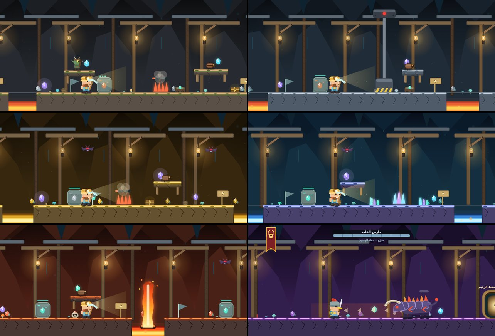
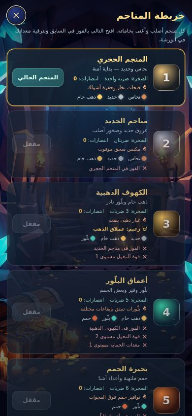
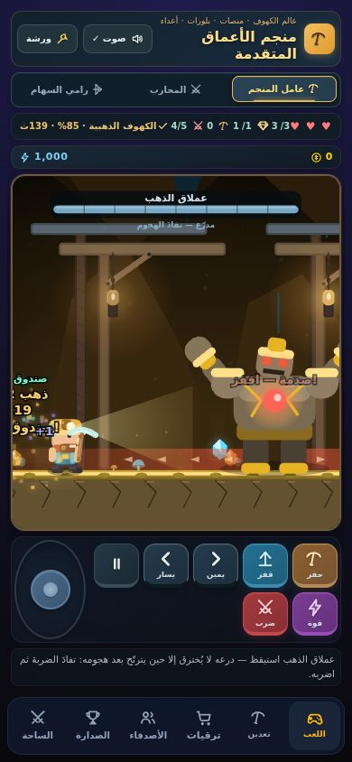
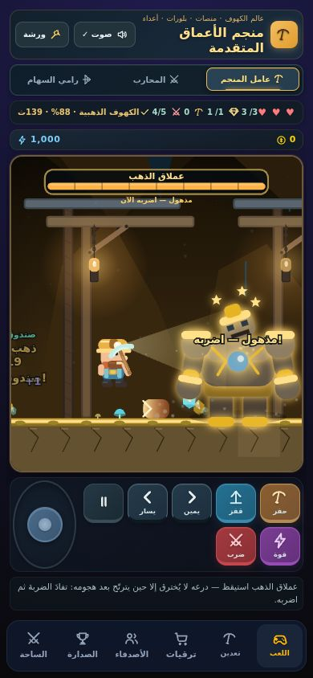
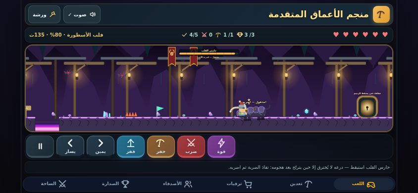

# عوالم المناجم والزعيمان — المحرك V5

كان لكل المناجم الستة مستوى واحد مشترك (فقط الصخر أصلب والأعداء أقوى) ولا زعيم في أي منها. اختار المستخدم «2 3 4» من قائمة التحسينات، وهذا هو الخيار 2: **عالم لكل منجم بفخه المميّز، وزعيم في المنجم الثالث (الكهوف الذهبية) والسادس (قلب الأسطورة)**، مع تحقق الخادم من كل شيء بإعادة التشغيل كما في بقية الجولة.

| العوالم الستة | خريطة المناجم |
| --- | --- |
|  |  |

| إنذار الصدمة | الزعيم مترنّح (الفرصة الوحيدة) | حارس القلب يستعد للاندفاع |
| --- | --- | --- |
|  |  |  |

## الملخص

| البند | الحال |
| --- | --- |
| المستويات | `R.LEVELS` فيه 6 مستويات كاملة (أرض وفجوات وحواف وصخور وبلّورات وأخطار وحرّاس وراياتٌ). المنجم 0 **حرفياً كما كان**: اختبار التطابق مع محرك V3 المجمَّد يقارن كل إطار على مسارات عشوائية (>15 ألف إطار) وما زال ناجحاً. |
| الأخطار | لكل عالم خطره: مكبس سحق (الحديد)، غبار ذهبي (الذهب)، بلّورات بأطوار مختلفة (البلّور)، نوافير حمم فوق الفجوات وشعلة (الحمم)، مكبس مع الحارس (الأسطورة). |
| الزعماء | عملاق الذهب وحارس القلب. دورة حتمية: مشي ← إنذار ← هجوم ← ذهول. **مدرّع إلا وهو مذهول**. |
| الخادم | سقوط الزعيم يُحتسب من إعادة تشغيل الخادم (`adventure.bossWins`)، فيُفتح إنجاز «قاتل الزعماء» الذي لم يكن ينال أحد، ويظهر في الإيصال وسجل التدقيق. |
| الاقتصاد | الذهب والسقف 100 والمعالم الخمسة **لم تتغير**. الجديد الوحيد: **غنيمة الزعيم خامات فقط** (انظر «الاقتصاد» أدناه، وهي النقطة الوحيدة التي تحتاج موافقتك). |
| التوافق | `VERSION` صار 5: الجولة الجارية وقت التحديث تنتهي صلاحيتها (الخادم يردّ 409، والعميل يتجاهل الحفظ القديم). سقف مقاطع الحركة 2400 بدل 1000، وحدّ جسم الطلب 64kb بدل 32kb. |

## العوالم الستة

| # | المنجم | الفجوات | الأخطار (النشاط/الدورة بالإطارات) | ملاحظات |
| --- | --- | --- | --- | --- |
| 0 | المنجم الحجري | 2 (90، 110) | فتحة بخار 84/180، حفرة أشواك | كما كان تماماً |
| 1 | مناجم الحديد | 3 (95، 105، 95) | **مكبس سحق** 90/220، حفرة | عالٍ وموقوت: انتظر نافذته |
| 2 | الكهوف الذهبية | 2 (100، 100) | غبار ذهبي 96/180، حفرة | **زعيم: عملاق الذهب** |
| 3 | أعماق البلّور | 3 (90 ×3) | بلّورات 102/180، بلّورات 60/150 بطور +40، حفرة | إيقاعان مختلفان معاً |
| 4 | بحيرة الحمم | 3 (105، 110، 105) | **نافورة حمم فوق الفجوة الأولى** 108/240، ونافورة ثانية 70/210 بطور +60، حفرة، شعلة 70/170 بطور +20 | اعبر الفجوة في لحظة هدوء النافورة |
| 5 | قلب الأسطورة | 2 (100، 100) | مكبس 114/240، حفرة | **زعيم: حارس القلب** |

مدة نشاط الفخ الأول (المعلَّم `vent: true`) تأتي **من المنجم وحده** (`MINES[i].vent`: 84، 90، 96، 102، 108، 114) فتزداد صعوبته مع المنجم. لا تُكرَّر في بيانات المستوى (والمنجم 0 يبقى بقيمته القديمة). يشرح الواجهة وقتَ التنشيط بإنذار: ضوء المكبس يصفرّ ويهتز قبل النزول، والنافورة تغلي وترتفع، والبلّورات ترتجف.

**ثوابت لا تتحرك بين المناجم**: 3 صخور و10 بلّورات و6 حرّاس في كل مستوى (غير الزعيم)، فلا تتغير أرقام المكافأة. النطاقات العشوائية للصخور والبلّورات داخل كل مستوى، والمنجم يضيف الصلابة وصحة الأعداء وسرعتهم كما كان.

## كيف يُوصَف المستوى (للمطوّر)

`makeLevel(spec)` في `public/platform-rules.js` يبني نفس بنية المنجم 0 من وصف مختصر: `ground` (مقاطع الأرض؛ الفراغ بينها فجوة)، `ledges` (`[x, y, عرض]`)، `rocks`/`gems` (نطاقات التوزيع)، `hazards`، `guards` (حارس على حافة أو خفاش بين x0..x1)، `checkpoints`، `signs`، و`boss` اختيارياً. المستويات الخمسة الجديدة في `WORLD_SPECS`.

**قواعد الفسحة** (يفرضها `test/fixtures/platform-level-lint.cjs` على كل مستوى جديد، وهي سبب كون المستويات قابلة للفوز لا مجرد مرسومة):

- لكل عائق «منطقة» لا يلمسها غيره: الفجوة `[بدايتها − 70، نهايتها + 70]` (مسافة جري وهبوط)، الخطر القصير `[x − 70، x + w + 70]` (يمكن للاعب التوقف في الهواء)، الخطر العالي `[x − 70، x + w + 30]` (مكان للانتظار).
- لا صخرة داخل منطقة، ولا حافة داخل منطقة (ارتطام الرأس يفسد القفزة) ولا فوق صخرة (الوقوف على صخرة تحت حافة منخفضة يحبس اللاعب)، ولا حافة معلّقة فوق فجوة.
- الحواف على ارتفاع يبلغه قفز واحد (y بين 222 و234)، والخفافيش أعلى من أي قفزة (y ≤ 125)، والبلّورات على الأرض أو حافة، والراية على أرض.
- ساحة الزعيم: لا حواف فيها، والزعيم لا يمشي فوق خط استيقاظه ولا يصل إلى البوابة، وراية الساحة خارج مداه.

## الزعيمان

| | عملاق الذهب (منجم 3) | حارس القلب (منجم 6) |
| --- | --- | --- |
| الصحة | 17 + 1 (المنجم) = **18** | 29 + 3 = **32** |
| الجسم (يؤذي) | 58×66 (يُرسم أكبر ×1.55) | 56×46 (يُرسم ×1.5) |
| المشي | 46 بكسل/ث | 63 بكسل/ث |
| الهجمات | صدمة فقط | اندفاع ثم صدمة؛ عند الهياج: اندفاع، صدمة، اندفاع |
| الإنذار قبل الهجوم | 40 إطاراً (الهياج 30) | 44 إطاراً (الهياج 32) |
| الصدمة | موجتان أرضيتان 30×22 بسرعة 230 تجريان نحو 245 بكسل | الموجتان بسرعة 250 نحو 267 بكسل |
| الاندفاع | — | 269 بكسل/ث حتى 70 إطاراً (≈ 314 بكسل) أو الجدار؛ الارتطام بالجدار يزيد الذهول 20 إطاراً |
| الذهول بعد الهجوم | 80 إطاراً | 70 إطاراً |
| يستيقظ عند | x = 1750 (ساحته 1800–2440) | x = 1800 (ساحته 1840–2450) |
| راية الساحة | 1610 | 1690 |
| الغنيمة | ذهب خام 1 + بلّور 2 (≈ 32) | حمم 3 (≈ 60) |

**القواعد:**

1. **مدرّع إلا وهو مذهول.** كل ضربة (سيف، سهم، قوة المعدّن، اندفاع المحارب) خارج مرحلة الذهول تُردّ بضرر 0 ويظهر ذلك للاعب (رنين معدن، كلمة «مدرّع»، وشريط الصحة رمادي مزرق). عند الذهول يصير الشريط برتقالياً نابضاً ويكتب «مذهول — اضربه الآن» وتدور حوله النجوم. الزعيم النائم مدرّع أيضاً فلا يوقظه سهم من بعيد.
2. **الإنذار مرئي ومسموع**: عند بدء الإنذار تُرسم على الأرض حارة حمراء بطول ما ستقطعه الصدمة أو الاندفاع فعلاً، وتصدر نبرة صاعدة وكلمة عائمة («صدمة — اقفز!» / «اندفاع!»). الزعيم خارج الشاشة (الهواتف الضيقة) يظهر له سهم عند الحافة بكلمة الهجوم. الكاميرا (للعرض فقط) تنزاح بالقدر اللازم ليبقى الزعيم كاملاً في الشاشة إن أمكن.
3. **الاندفاع باتجاه يُثبَّت عند بدء الإنذار**، فمن يعبر فوق الزعيم يتركه يجري في الفراغ.
4. **المثابرة لا الحظ**: الإصابة تعيدك إلى راية الساحة وصحة الزعيم باقية كما تركتها؛ لا يملك الزعيم عشوائية ولا يتجدد.
5. **البوابة مقفلة حتى يسقط الزعيم** (نصها على البوابة: «مغلقة حتى يسقط الزعيم»). بلا زعيم الشروط كما كانت (3 بلّورات وصخرة).
6. **لا نقطة آمنة للرامي**: موجات الصدمة أبعد مدىً من سهمه (245 و267 مقابل 240)، فمن يقف ويرمي بلا حركة لا يفوز أبداً (يختبر ذلك `platform-worlds.test.js` على 12 موضعاً).

## أرقام العدالة (مقيسة بلاعب آلي قانوني بلا معدات إطلاقاً)

اللاعب الآلي `test/fixtures/platform-bot.cjs` يضغط الأزرار الستة نفسها ولا يقرأ إلا حالة الجولة. **رد فعله مثالي**، فهذه حدود دنيا لما يحتاجه الإنسان لا قياس لإحساس لعبه.

| الزعيم | البطل | مدة المعركة | كل الجولة | قلوب خسرها |
| --- | --- | --- | --- | --- |
| عملاق الذهب | عامل المنجم | 951 إطاراً (16ث) | 1633 | 0 |
| | المحارب | 712 (12ث) | 1802 | 0 |
| | الرامي | 1128 (19ث) | 2142 | 0 |
| حارس القلب | عامل المنجم | 1386 (23ث) | 2354 | 0 |
| | المحارب | 794 (13ث) | 2797 | 0 |
| | الرامي | 1594 (27ث) | 3471 (58ث من 150ث) | 0 |

- **نوافذ المراوغة**: القفز فوق الموجة ينجح إن كان طرفها على بعد 35–130 بكسل (عند 20 يفشل مع العملاق)؛ وللصدمة القريبة تنجح القفزة في آخر 0–22 إطاراً من إنذار الـ40 (نافذة ≈ 0.37ث)؛ وللاندفاع ينجح أي توقيت من 4 إلى 24 إطاراً قبل التلامس بعد التراجع أثناء الإنذار.
- **من لا يقفز أبداً**: عامل المنجم والرامي لا يفوزان بأي من الزعيمين (يثبت ذلك اختبار)، أما المحارب (4 قلوب وضرر 2) فقد فاز في قلب الأسطورة بخسارة قلبين (قياس واحد، لم أقِسه مع عملاق الذهب).
- **لماذا يتراجع اللاعب الآلي عند إنذار الاندفاع؟** القفزة تحتاج مسافة جري ≈ 12 إطاراً لتعلو الزعيم، فمن يقف ملاصقاً له لا يلحق. هذه قاعدة لعب لا عيب في اللاعب الآلي، والإنذار 44 إطاراً يكفي للتراجع.

## الاقتصاد (النقطة التي تحتاج موافقتك)

- **لم يتغير**: الذهب لكل جولة (سقف 100: 5 معالم × 12 + الباقي عند الفوز)، المعالم، الأسعار، الحدّ اليومي، التبريد 20 ثانية.
- **الجديد**: عند سقوط الزعيم تُضاف `BOSS_SLOTS = { mid: 1, rare: 2 }` من خامات المنجم نفسه (ثابت واحد في `platform-rules.js`):
  - الكهوف الذهبية: ذهب خام 1 + بلّور 2 = **32 ذهباً بسعر البيع**.
  - قلب الأسطورة: حمم 3 = **60**.

  هي تقريباً ما تعطيه صخرة واحدة في ذلك المنجم، ويدفعها الخادم من إعادة التشغيل فقط (لا قيمة من العميل). تعديلها سطر واحد، وأي رقم آخر يكسر اختبارات الغنيمة عمداً فتُراجع.
- قتل الزعيم يحقق أيضاً معلم «حارس مهزوم» (إن لم يُنَل)، ولا يزيد سقف المعالم.
- **مهمة `boss` اليومية/الأسبوعية ما زالت مستبعدة من الاختيار** (`UNREACHABLE_MISSION_KEYS`): الاختيار عام لكل اللاعبين ولا يعرف أي منجم فتحوه، فقد تعطي لاعباً مهمة مستحيلة. الإنجاز يعمل الآن، والمهمة تحتاج جعل الاختيار واعياً بحساب اللاعب (جولة لاحقة بموافقتك).

## الواجهة

| الملف | الدور |
| --- | --- |
| `public/platform-scenery.js` | جلد كل عالم (صخر وسائل ولون)، ديكورات الأرض المشتقة من بيانات المستوى (فلا يقع ديكور فوق صخرة أو خطر أو راية)، أنواع الأخطار، لافتتا بوابة ساحة الزعيم |
| `public/platform-bosses.js` | رسم الزعيمين بالمتجهات (بلا صور)، حارة الإنذار، الموجات، شريط الصحة، سهم الحافة |
| `public/platform-renderer.js` | كل `R.LEVEL.*` صار مستوى الجولة (`R.levelFor(s.zone)`)؛ المنجم 0 يرسم بألوانه القديمة حرفياً |
| `public/platform-game.js` | أصوات الزعماء (إنذار صاعد، ضربة، انهيار، رنين الدرع)، اهتزاز وغبار وكلمات عائمة، صف «اهزم الزعيم» في بطاقة المهمة، رسائل في سطر الحالة |
| `public/index.html` | صفّ الزعيم في البطاقة، أيقونة SVG `i-boss`، سطر «الخطر» وشارة «زعيم» في خريطة المناجم |

تقليل الحركة يعطّل الاهتزاز والجسيمات والنبض في كل ذلك. لا إيموجي في الفن الجديد (يمنعه اختبار).

**ملاحظة وجدتها أثناء العمل**: الدالة `feedback()` في `platform-game.js` لا تفعل شيئاً منذ زمن لأن عنصر `#platform-feedback` لم يعد موجوداً في الصفحة، فرسائل مثل «تكسّر العِرق» و«راية مفعّلة» لا تظهر. لم أصلحها (خارج الطلب) لكنني وجّهت رسائل الزعيم إلى سطر الحالة الموجود، ويمنع اختبار العودة إلى `feedback()` هناك.

## الاختبارات

- `test/platform-worlds.test.js` (22): فحص هندسة المستويات، قابلية الفوز لكل بطل ومنجم وعدة بذور بمعدات فتح المنجم **وبلا معدات** مع تطابق إعادة الخادم، أن الإثبات مرتبط بالمنجم والمعدات، دورة الزعيم وإنذاره وموجاته واندفاعه وهياجه وراية الساحة والغنيمة وقفل البوابة، التعذّر على من يقف ويرمي أو لا يقفز أبداً، الكاميرا، وأن اللاعب الآلي لا يستعمل إلا الأزرار الحقيقية.
- `test/platform-worlds-ui.test.js` (10): المُصيِّر الحقيقي على سياق رسم وهمي لكل منجم وطور خطر وحالة زعيم، وتطابق التوقيت المرسوم مع الحقيقة في المحرك، ومواضع الراية واللافتات من المستوى، ومعالجة كل حدث زعيم بصوت ورد فعل.
- `test/platform-api.test.js` (+3): عدّ القتل من الخادم، عدم عدّ زعيم قائم، وحدّ الجسم.
- **اختبار الطفرات**: 64 طفرة في القواعد والرسم والخادم، **63 قُتلت** (والأخيرة كانت مكافئة لأن الرقم مكرّر، فأزلتُ التكرار من المصدر وصارت تُقتل).
- `npm run test:bosses` (يشتغل في CI): متصفح حقيقي يفتح خريطة المناجم، يفتح المنجم للضيف، يشغّل جولة الزعيم بحركات اللاعب الآلي عبر دالة الخطوة نفسها في العميل (`PlatformGame.feed`)، ويفحص الشاشة عند الاستيقاظ والإنذار والذهول والسقوط، ثم يتأكد أن الخادم عدّ القتل وأضاف الخامات كما أُعيدت. عملاق الذهب بحركة كاملة وحارس القلب بتقليل الحركة. لتجاوز فحص «أسرع من الزمن الحقيقي» يقدّم السكربت وقت بدء الجولة في ملف SQLite التطويري.

## كيف تضيف عالماً أو زعيماً

1. أضف وصف المستوى إلى `WORLD_SPECS` (والزعيم في `boss: { … }`)؛ شغّل `node --test test/platform-worlds.test.js` فيفحص الهندسة ويلعبه اللاعب الآلي تلقائياً بكل بطل.
2. أضف جلداً في `SKINS` و«ثيمة» ديكور في `THEME` (`platform-scenery.js`) وسطر خطره في `WORLD_DANGER` (`index.html`)؛ تنبّهك اختبارات الواجهة إن غاب أحدها.
3. لزعيم جديد: ارسمه في `platform-bosses.js` وأضف حدثاً (إن وُجد) إلى `PlatformGame.consumeEvents` وإلى `beep`؛ يتحقق اختبار «كل حدث يُسمع ويُرى» من ذلك.

## ما لم يُجرَّب (بصراحة)

- جهاز لمس حقيقي أو تيليجرام. شاشة الهاتف الضيقة تعتمد على الكاميرا وسهم الحافة، وهما مفحوصان بالكود والمتصفح المكتبي لا بيد لاعب.
- إحساس اللعب بيد إنسان: الأرقام أعلاه لاعب آلي مثالي. الصعوبة الفعلية (هل 3 قلوب كافية للمبتدئ؟ هل الإنذار مريح؟) تحتاج لاعباً حقيقياً، ومفاتيحها كلها أرقام في `WORLD_SPECS`.
- فن الزعيمين مرسوم بالمتجهات في الكود (لا صور)، ويمكن استبداله لاحقاً بفن مولَّد.
- الجولات الجارية وقت التحديث إلى V5 تضيع (مقصود ومُعلن).
